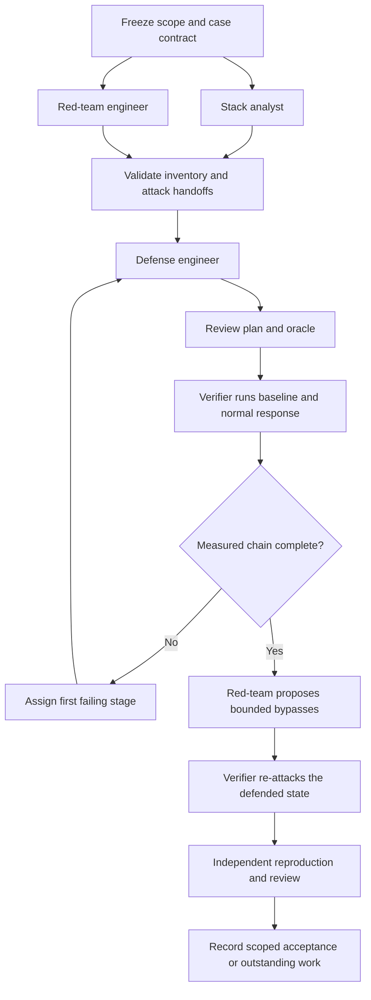

# Agentic verification workflow — V1

Version: 1.0. Frozen before the first architecture trial on 10 October 2026.
Status: experiment design, not a production agent service.

## Objective and experiment

Build a workflow that turns a workload-specific attack into a reproducible,
independently reviewed account of observation, brain selection, execution,
enforcement and legitimate-service effects. Agents may discover and implement;
measured application behavior establishes the outcome. A selected actuator or
successful operation receipt is insufficient.

First evaluate the workflow using the implemented stolen-caller-credential case:
credential A and legitimate credential B both work initially; the unchanged
brain selects a response; the native actuator executes; subsequent reuse of A
must be denied without stopping B. The environment is a private real Kubernetes
API server plus shipped Python admission boundary and synthetic downstream.
The observation is explicitly test-injected. This trial cannot certify an
autonomous detector, deployed console, GPU inference or production availability.

The input code is pinned to `f73d04cd6aac9f5945da1515e2dac76554869920`, built
on main `54c9273a6faaa3768e55adf15afb51de68b3241b`. The workflow experiment
uses a separate branch; it does not modify the open one-case PR or shared cluster.

## Roles and ownership

| Role | Owns | Required output | Does not own |
| --- | --- | --- | --- |
| Orchestrator | Scope, case contract, assignments, budgets, routing and final disposition | Ordered run ledger, dependency pins, accepted architecture | Fabricating missing observations |
| Stack analyst | Relevant source/runtime inventory and twin fidelity | Source-backed inventory and declared omissions | Attack execution or product edits |
| Red-team engineer | Runnable attack, successful baseline, realistic variations and re-attack | Attack specification, probes and bounded bypass candidates | Defense certification |
| Defense engineer | Existing-response fit, missing integration and new actuators where needed | Candidate analysis; reviewed implementation when needed | Reviewing its own implementation |
| Verification engineer | Case execution and complete chain evidence | Reports, first failing stage, positive/negative controls | Product repair or accepting its own harness changes |
| Independent reviewer | Attack validity, oracle integrity, source/evidence pins, reproduction | Findings and independent acceptance/rejection | Authoring the artifact being certified |

V1 instantiates all six roles for one case, including the orchestrator. GPT-6.1
Sol is used for the five workers. Roles are responsibilities, not invented
personality prompts. There is one writer per artifact. The verifier exclusively
owns runtime mutation within this case; other agents may read its evidence.

## Graph and handoffs



The initial case contract is fixed before execution. Agent recommendations can
change it only through a new contract revision and trial. A role completion is
an artifact, not a chat assurance. Each handoff includes:

```json
{
  "schema": "phorvex.agentic-handoff.v1",
  "run_id": "v1-pilot",
  "role": "stack_analyst",
  "status": "ready",
  "started_at": "UTC RFC3339",
  "finished_at": "UTC RFC3339",
  "input_refs": [{"path": "relative/path", "sha256": "64 hex"}],
  "source_revision": "40 hex",
  "findings": [],
  "artifacts": [{"path": "relative/path", "sha256": "64 hex"}],
  "limitations": [],
  "next_owner": "orchestrator",
  "next_action": "Validate this output and route the case"
}
```

The orchestrator checks required fields, source revision and input/output file
hashes before forwarding a handoff. It preserves failed and superseded artifacts.
The source revision labels code; actual source and binary hashes bind execution.
No process secret belongs in an agent artifact, graph state or report.

## Execution stages and verdicts

1. Inventory relevant endpoints, identities, policies, capabilities and runtime
   assumptions. Reject a stale or incompatible fixture.
2. Establish actual attack and legitimate-operation baselines. A blocked attack
   is `NOT_LANDED`, with no fresh brain-defense credit.
3. Establish the observation path. Label `REAL_DETECTOR`, `REAL_TELEMETRY` or
   `TEST_INJECTED`. Missing admission or trust routes to integration work.
4. Let the unchanged brain choose from the fixed policy's feasible candidates.
   Capture exclusions and no-action reasons. Do not force an expected action.
5. Execute the selected native response and retain independent effect probes.
6. Compare identical attacker capability after response; measure B during and
   after dispatch. Separate modeled cost, formal SLO bound and sampled behavior.
7. Run clean/stale controls, exact-input replay and bounded re-attack. Candidate
   comparisons start from fresh baselines; bypass probes target defended state.
8. Independently reproduce and report the case, including unresolved claims.

Threat outcome: `LANDED`, `BLOCKED`, `NOT_LANDED` or `UNKNOWN`.
Brain attribution: `PROVEN`, `NOT_PROVEN` or `NOT_EXERCISED`.
Acceptance: `LOCAL_ACCEPTED`, `REWORK`, `INCOMPLETE` or `BUDGET_EXHAUSTED`.
These dimensions are separate. An outage is not a blocked threat; a blocked
threat with broken legitimate service is not accepted. Unknown formal SLO bounds
remain unknown even if local legitimate probes pass.

New actuator work, when necessary, must specify attacker capability removed,
workload scope, permissions, authenticated interface, coverage, cost/availability
assumptions, completion evidence, recovery and regression probes. Changes to the
brain are a separately reviewed version, never mid-trial tuning. No viable
existing actuator triggers engineering, rather than immediate `CANNOT_DEFEND`.

## Tools and LangGraph transfer

Agents receive narrow logical tools: `read_source`, `read_inventory`,
`propose_attack`, `propose_defense`, `write_owned_artifact`, `request_run`,
`read_evidence`, `request_review`. Runtime tools are deterministic adapters:
`freeze_contract`, `verify_refs`, `run_episode`, `replay_decision`,
`classify_evidence`, `cleanup`, `append_ledger` and `route_failure`.
Only the verifier receives `run_episode`; edits are bounded to its assigned
artifact or implementation branch. Reviewer inputs contain independent probes
and source pins, not just the implementation agent's conclusion.

Future LangGraph nodes follow these stages, with a typed case state and
conditional edges for failures. State contains IDs, revision/hash references,
budget counters, task ownership, observation mode, stage results and verdict
dimensions. Large logs remain content-addressed artifacts. One case corresponds
to one checkpointed thread. Per-case state is separate from the scheduler's
global work queue. A workload lease serializes physical mutation.

Side effects need operation IDs and readback before retry: a resumed graph must
not blindly fire an attack or actuator again. Source/contract/runtime drift
invalidates affected evidence. A checkpoint is orchestration persistence, not
proof that the original physical environment still exists.

The framework mapping follows the official [Graph API](https://docs.langchain.com/oss/python/langgraph/graph-api)
and [persistence documentation](https://docs.langchain.com/oss/python/langgraph/persistence).
LangGraph implementation is intentionally deferred until this architecture has
been evaluated with actual Codex workers.

## Budgets and architecture acceptance

For this exercise: one workload, at most six simultaneous roles, at most three
architecture versions, at most two targeted rework rounds per version. Commands
have explicit timeouts. No repeated failing trial without a concrete change.
These are configurable experiment limits; exhaustion is not a successful case.

Required observations:

- A fresh measured positive response chain and legitimate controls.
- A withheld-dispatch control that lands despite brain selection.
- An authority-outage control that stays incomplete, never defended.
- Exact-input replay and independent reproduction.
- A bounded, honestly reported re-attack and teardown.
- Successful stage ownership and first-failure routing without user relay.
- No self-certification, unpinned evidence reuse or shared runtime races.
- Recorded worker starts/finishes, handoffs, command/run count, rework and
  routing intervention. Model-token cost is unknown unless actually exposed.

Revise V1 if gates require unstated human judgment, roles duplicate work, evidence
does not match the contract, or failure/retry/resume semantics are ambiguous.
Select the simplest version that passes these checks. One case cannot establish
a globally optimal roster, full customer-stack coverage or a universally secure
defense. The deliverable is a tested workflow suitable for a larger pilot.
