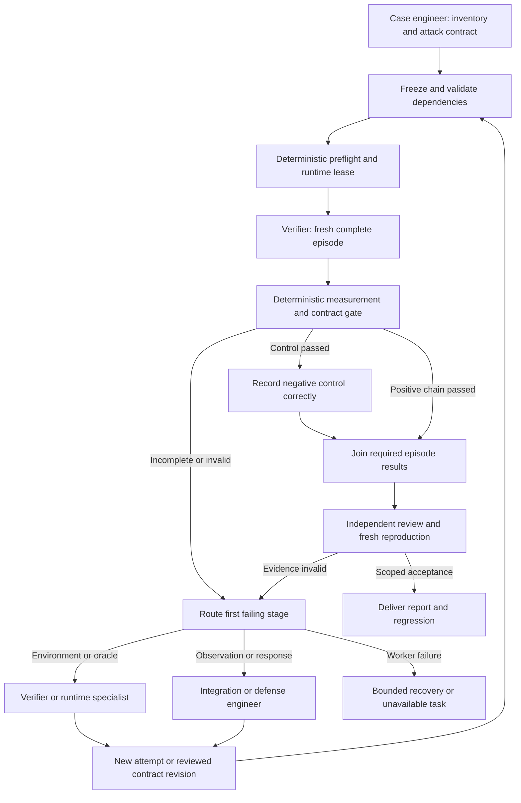

# Agentic verification workflow — V2

Version: 2.0. Candidate following the observed V1 trial.
Status: freeze before V2 execution; acceptance is recorded in RESULTS.md.

## What V1 taught us

V1's existing actuator passed the measured local case. Its separate role and
handoff design did not pass: nine independent preflight findings, a worker that
returned no artifact, contradictory runtime ownership, manual verdict mapping,
and a post-run re-attack step that the tool's teardown made impossible. Adding
more attack personas would not fix those failures. V2 simplifies routine case
ownership and adds deterministic contract, measurement and routing gates.

The optimization target is correct evidence with fewer unnecessary handoffs,
bounded repair, reproducible execution and predictable recovery. We have not
measured model-token cost or found a universal optimum across customer stacks.

## Roles: four routine participants, specialists on demand

| Role | Responsibility | Activation |
| --- | --- | --- |
| Orchestrator | Scope, frozen contract, source pins, task identity, budget and routing; runs deterministic gates | Once per campaign; no agent agreement can override a failed gate |
| Case engineer | Relevant inventory, realistic attack specification, observation contract and proposed defended-state probes | Once per new case or invalidated inventory; combines V1 analyst and red-team handoff |
| Verifier | Independent measurement plan, private runtime execution and cleanup; records first incomplete stage | Each fresh physical trial; owns that episode's mutation lease |
| Independent reviewer | Reviews authored artifacts, independently reproduces and challenges conclusions | Before unreviewed execution changes and before final acceptance |
| Defense/integration engineer | Existing response fit, real integration repairs or a new actuator | Only for a demonstrated response gap; not for successful existing responses or intentional failure controls |
| Runtime/domain specialist | Missing environment fidelity, detector, network, SRE or application-specific knowledge | Only when a concrete prerequisite or review finding requires it |

There is no permanent six-agent roster per simple case. The orchestrator can
reuse reviewed, source-pinned inventory and response analysis, but never reuse
physical results as fresh verification. A specialist task has a precise missing
input and deliverable, not an invitation to independently rerun the campaign.

## State and graph

Each case carries:

- `run_id`, `case_id`, schema version, contract revision and SHA-256;
- immutable source and execution pins, runtime scope and observation mode;
- tasks with supervisor-assigned actor/role, attempt and episode IDs;
- accepted dependency references, operation IDs and mutation leases;
- stage measurements, raw verdict, threat outcome, attribution and acceptance;
- counters for fresh trials, targeted rework and provider failures;
- terminal disposition and exact unavailable prerequisites.

Agent outputs are proposals. Supervisor-supplied actor identity, validated file
references and deterministic results are authoritative. A model-written role
name is not authenticated identity. Artifact authors cannot independently review
their own files. Append-only logs retain old attempts; case state points to the
currently accepted dependencies. Contract or source changes invalidate affected
results. A wrong contract, wrong episode or changed file is rejected before use.

## Case contract

The case engineer specifies the owned workload and attacker capability, the
successful baseline, legitimate-operation probe, allowed observation path,
native candidate interface, expected denial/effect and availability budget.
It also supplies the supported tool inputs and exact untested claims.

The pilot's adapter supports `endpoint-lease-revoke` only. Selection is still
natural and unchanged; if the brain selects another action the adapter reports
unsupported verification, rather than calling it an incorrect brain decision
or forcing the expected response. General tools must declare other response
interfaces and corresponding effect oracles before certifying them.

The pilot is `TEST_INJECTED`, a local response-chain verification. A customer
full-chain case instead requires actual detector/telemetry production and its
admission/trust proof. Neither mode can be relabelled after execution.

## Runtime lifetime and re-attack

Choose one supported runtime contract before executing:

1. **Self-contained episode**, used here. Baseline, observation, normal brain,
   dispatch, attacker/legitimate probes and predeclared defended-state retests
   run before the same command tears down. The hold probes vary request nonce;
   they test the same capability, not adaptive discovery of novel bypasses.
2. **Leased persistent twin**, future adapter. It exposes provision/inspect/
   run/reattack/cleanup with an explicit environment ID. Red-team proposals are
   executable probe plans; only the lease owner executes them before cleanup.
   This lifecycle is specified but not implemented or validated by this pilot.

Never attach a re-attack claim to a destroyed runtime or mistake a fresh episode
for continuation of its previous defended state. New variations require a
reviewed adapter and revised contract. Bounded no-bypass results cannot certify
an entire application attack surface.

The verifier releases its lease after confirmed cleanup. The reviewer then
acquires a distinct independent episode. Separate private environments may run
in parallel if the scheduler proves disjoint mutation resources. Shared workload
mutation is serialized, irrespective of how many model calls are concurrent.

## Outcomes and routing

| Evidence | Threat | Brain attribution | Task disposition |
| --- | --- | --- | --- |
| Successful baseline, selected/native response, specific denial, legitimate controls and hold pass | BLOCKED | PROVEN_LOCAL_RESPONSE | POSITIVE_PASS |
| Intentionally withheld dispatch; A still performs the operation | LANDED | SELECTION_ONLY | CONTROL_PASS, never defense credit |
| Intentionally unavailable authority; A receives 503 | UNKNOWN | NOT_PROVEN | CONTROL_PASS for outage honesty, never defense credit |
| Already blocked baseline | NOT_LANDED | NOT_EXERCISED | CASE_NOT_ESTABLISHED |
| Wrong source/contract, missing proof, outage or unexpected tool behavior | UNKNOWN | NOT_PROVEN | INCOMPLETE or REWORK |

A case requires all declared controls and independent review to reach
`LOCAL_ACCEPTED`. Formal SLO `unknown` remains a distinct unresolved field.
`LOCAL_ACCEPTED` does not mean architecture G2, production acceptance or full
autonomous chain acceptance. If the contract requires those stronger claims,
unknown proof routes to `INCOMPLETE`, not relaxed criteria.

| First failing stage | Next owner/action |
| --- | --- |
| Worker/provider error | Orchestrator records failed task; no unchanged blind retry or safety-circumventing delegation |
| Stale dependency, wrong contract, duplicate/ambiguous operation | Deterministic supervisor rejects or reconciles |
| Tool/assets/runtime prerequisite | Verifier; runtime specialist only if needed |
| Attack fails to establish unauthorized capability | Case engineer investigates baseline; no invented success |
| Observation not produced/admitted | Integration engineer or real detector/telemetry owner |
| No action, unsupported action or candidate exclusion | Inspect exact policy, coverage, feasibility and scoring reasons; repair only a demonstrated defect |
| Native dispatch/readback failure | Defense/integration engineer |
| Execution reported complete but attacker capability remains | Defense engineer repairs or designs an appropriate actuator |
| Legitimate traffic or affected workload fails | Defense/runtime specialist; rejected availability claim |
| Incorrect console/reporting verdict | Reporting integration engineer; repeat via same console path |

Expected negative controls are not routed to product engineering. Measurement
errors are not actuator defects. No available existing response is not a final
`CANNOT_DEFEND`: first evaluate scoped engineering. External constraints or
budget exhaustion preserve the valid attack and exact missing protection.

## New actuator branch

When the evidence demonstrates a capability not removed by existing responses:

1. Defense engineer defines the effect and narrow workload scope, authenticated
   API, permissions, idempotency/readback/recovery, completion evidence,
   coverage facts and honest cost/availability assumptions.
2. It implements the response and registration/capability/coverage integration
   in an isolated branch. The orchestrator does not make a confidence-based
   actuator selection on its behalf.
3. Independent code and oracle review rejects unsafe authority or fake effect.
4. Freeze the changed code, adapter and case contract as a new trial. The
   unchanged versioned brain makes its ordinary choice; rerun baseline,
   enforcement, legitimate controls and defended-state retests.
5. Deliver only the observed claim. Unknown SLOs, missing detectors or gaps in
   deployment verification remain outstanding; do not tune them away mid-run.

This branch is part of the design, not a claim that this credential pilot created
or validated a new actuator. Here the existing response already fits.

## Recovery and budgets

Task states are `PREPARED`, `RUNNING`, `SUCCEEDED`, `FAILED`, `AMBIGUOUS` and
`UNAVAILABLE`. An operation ID binds case, contract, episode and tool inputs.
Re-delivering a terminal request returns the retained result without new physical
execution; it is cached evidence, not fresh verification. An interrupted running
mutation becomes `AMBIGUOUS`: inspect/readback before any retry. For this
self-contained private fixture, the environment may already be gone, so the
only valid recovery is preserved incomplete evidence plus a new fresh episode.

Bound targeted repairs to two per version, architecture trials to three versions,
and physical commands to their declared timeout. A failed worker cannot silently
consume an unlimited fresh-agent budget. A reviewed existing fixture may continue
as a separately recorded narrower task; a provider refusal is not bypassed by
delegating the same blocked request elsewhere.

## LangGraph implementation boundary

The future graph uses typed state, deterministic conditional routing, per-case
checkpoints and a scheduler outside the case graph. Model nodes propose typed
plans; normal functions run gates/tools. Full prompts, machine handoff shape,
tool contracts and checkpoint/retry mapping accompany this architecture.

The pilot uses Codex workers and a small standard-library protocol gate. It is
not a LangGraph deployment or an automatic LLM scheduler. Tool isolation is a
role instruction in the Codex trial; production requires authenticated adapters
and enforced capability restrictions. The executable gate tests the contract
and evidence boundaries that the LangGraph adapters must preserve.

Acceptance requires fresh V2 positive/negative runtime evidence, independent
reproduction, contract/actor/dependency validation, first-failure routing and
explicit teardown/retry semantics. Untested persistent-twin, customer discovery,
new-actuator engineering and production branches remain visible in the report.
