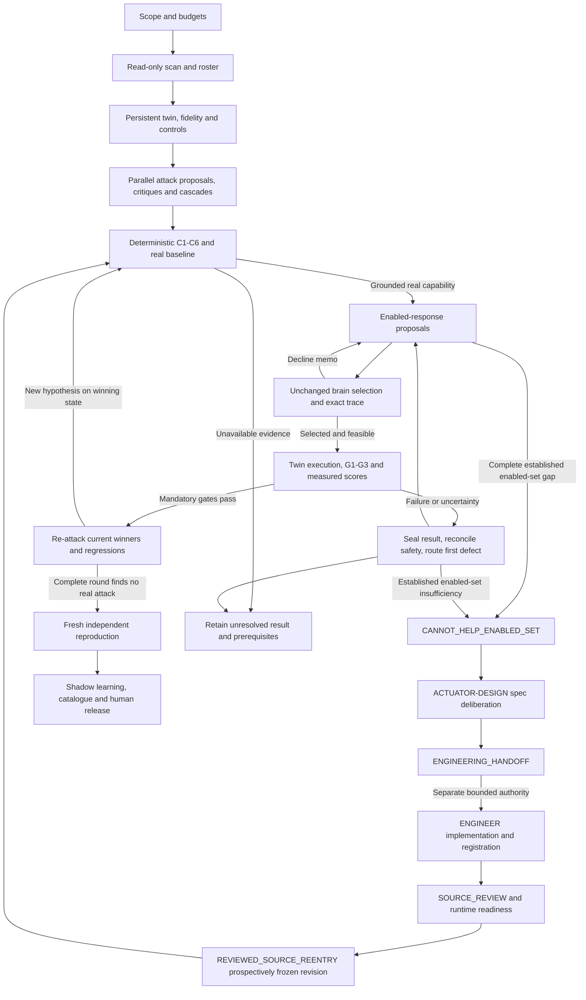

# Phorvex verification loop: V5 implementation contract

**Status: complete source-derived specification proposed for independent review;
not a completed physical verification loop.** LangGraph remains a later implementation
step. Existing source reviews, unit tests and bounded experiments establish only
their recorded scope. They do not establish this complete adaptive competition,
all seven measurements, a real scoped availability certificate, newly engineered
actuator success, or a 100-item catalogue. V4 and its reviews are immutable history.

V5 uses **boss architecture revision 4 plus all seven revised workstreams**.
Boss revision 4 and agentic architecture V4 are distinct version sequences.
The DOCX reconciles the workstreams; the detailed mapping and unresolved tensions
are in [SOURCE-REQUIREMENTS-V5.md](SOURCE-REQUIREMENTS-V5.md).
[PROMPTS-V5.md](PROMPTS-V5.md) contains full task contracts, and
[BOSS-REV4-CHANGE-ANALYSIS.md](BOSS-REV4-CHANGE-ANALYSIS.md) records the old/new audit.
The revised WS-3 already uses three gates/four scores and revised WS-5 already uses
one persistent twin per competition. Their old conflicting versions remain historical.

### Frozen source package

Verify the following original bytes before accepting a transferred requirements bundle.
Names identify portable source artifacts, not required machine-specific install paths.

| Original artifact | SHA-256 |
| --- | --- |
| Phorvex-Verification-Loop-Architecture-Rev4 (2).docx | `734d499a8a08b7ad47fdea97c8c510f321a479607f86ad4467c1a36d7ccf46c9` |
| WS-1-scan-sizing (1).md | `fc62f4212a1bd2d8ac9cb682af4f71dc29180ed0ccc460ebcf61fb730ab33c70` |
| WS-2-generator.md | `fb5da1e161a4c449ca68768f86f9d588ac473c73ecec879705d779435e261881` |
| WS-3-validator-rubric (1).md | `f5192fe92d988998de5bb1549c2d7913d6edb146d9cbe5d0334aeb61f5e55cb8` |
| WS-4-consensus.md | `45f4bab37602b09d8dfc5d580d2b6f3727b979e1991b026aa83bc4c866de1335` |
| WS-5-brain-in-loop.md | `58742302996f5151fdf6496bab7340944e2f3b7ef3af25c119fe025ec87b0f8c` |
| WS-6-rl-hook.md | `0d8bcabb03d70b5e266ddde7d30d804d16babf87c781d1aac4699d9345f8aa05` |
| WS-7-external-sota.md | `510afb8182f17bbbf12274c234f694a05bf7acd2645fa88e8c08d128385a6309` |
| SOURCE-REQUIREMENTS-V5.md | `7b74eca9d4087ad1db92212cb353b00be8c2fa6abe0736bdfd8c8faf340e1fd9` |
| BOSS-REV4-CHANGE-ANALYSIS.md | `53cc56f44369c4345fc9aa4bba50742264c66a0dfb17d3eb199988a1996f256d` |
| Preserved ARCHITECTURE-V4.md | `e3e6f81177b8a1e310ec007c6bac98351e7025b80c5b57c58ccff3f5da25d4e8` |
| Preserved PROMPTS-V4.md | `224a495db591dc6364e66ffc9804122694477327cba06b581a426d314c6aaae8` |

Source claim tags remain distinct: CODE-CITED (verify current bytes/interfaces),
DOC-CITED, INFERRED orchestration design, and UNVERIFIED. Literature figures are
external reference results, not benchmarks obtained by this workflow. No new
numeric defaults, approximation guarantees or throughput promises follow from Rev4.


## 1. Objective and the meaning of completion

The workflow discovers a real unwanted capability, develops sufficient
responses, and tests the complete chain:

**Observed stack → attack proposal → deterministic qualification → real baseline
→ enabled-response proposals → unchanged brain selection → native effect and
all gates → adaptive re-attack.** A confirmed uncontained capability may branch
through **spec-only design → separately authorized engineering → independent
review/registration → normal competition re-entry**; design itself is not defense.

An LLM proposes and critiques. Deterministic adapters, original observations,
the normal Phorvex brain, and independent measurements decide acceptance.
Agreement, candidate count, a console badge, resource creation, dispatch, or an
actuator's self-reported success cannot substitute for effect confirmation.

The output is a customer-scoped catalogue, integrated response implementations
where needed, a round ledger, exact decision traces, metric cards, reproducible
tests, and an explicit coverage/debt register. A finite catalogue never establishes
that a customer stack is invulnerable. `STABLE` is always qualified by the tested
snapshot, attack search space, budget, and complete final attack round.

Completion milestones are separate:

| Milestone | Required evidence | What it does not claim |
| --- | --- | --- |
| Phase 1 winning timed verdict | Genuine grounded attack and baseline on an isolated twin; brain selection; G1, G2, G3 all PASS; measured S1 | Completed adaptive competition, Phase 2 scores, or production readiness |
| Phase 1 completed competition | Phase 1 winning verdicts; persistent winner state; all registered regressions; complete final re-attack round and ledger; fresh independent reproduction and safe cleanup | Full cost/collateral calibration or universal protection |
| Phase 2 competition | Phase 1 plus measured S2, S3, S4 with declared units, windows, baselines and uncertainty | That a different customer deployment has equivalent inputs or enforcement |
| Published customer catalogue | Unique runnable items, source/runtime and scope pins, real detection mode, integrated actuators, per-item independent results and clear retest/deployment prerequisites | That every generated hypothesis has been implemented or defended |

Unknown mandatory gates block both phases. Unknown secondary scores remain
unknown and cannot win a comparison by being assigned zero. Phase 1 may carry
an explicitly incomplete seven-field card; it is not a full Phase 2 verdict.

## 2. Boundaries and source precedence

Production contributes a read-only scan. Attack execution defaults to a
separately provisioned twin, with its own identities, resource scope, data,
credentials, events and journals. A separate owner-authorized dev reference run
may verify the installed path. It is recorded as that mode and does not replace
the twin/isolation requirements. Permissions do not follow an agent to another
environment merely because the source is identical.

The brain remains structurally and numerically unchanged throughout a frozen
competition. Agents cannot force a winner, change event weights to secure a
selection, tune a policy after seeing the outcome, or inject an event into a
case registered as an installed-detector test. A documented implementation
defect goes to a separately authorized product-repair workflow, then a new
source revision and new evaluation; it is not fixed inside the experiment.

There are three labeled observation modes:

1. **Installed detector:** the workload attack causes the existing producer to
   observe and publish the qualifying evidence. This can establish detection.
2. **Observational test detector:** a separately authenticated observer publishes
   only after its frozen predicate actually holds. This tests response plumbing
   and a specified observation; it does not establish installed detector coverage.
3. **Injected response test:** an expressly authorized fixture supplies a signal
   to isolate response behavior. It is not a detection claim or a realistic
   full-chain result merely because the selected actuator succeeds.

Only the orchestrator accepts an execution mode and scope. Workload text,
prompts, tool outputs and logs are untrusted data, never agent instructions.
Secrets stay in an access broker or private access-reference files; no secret
values belong in agent prompts, reports or Git. Commit messages never contain
`Co-authored-by`, equivalent assistant attribution, or AI attribution.

Original source citations describe the source snapshot used by their author.
At launch, verify actual interfaces and semantics in the current revision.
Source Git fields, declared configuration, and image tags are separate from
observed image digests, effective configuration, and binary attestation. Missing
evidence stays missing. A unit test of owner-state isolation is not evidence
that networking, storage, GPU scheduling or all co-tenants are isolated live.

The newly present boss DOCX §19 describes its author's approval boundary; it
does not revoke current explicit user authorization or create a repeated approval
question for already scoped work. Source work, runtime admission and governed
promotion remain distinct capabilities. No designer role silently acquires engineer
tools. Adapters enforce the actual authority, rather than trusting a role label.

### Configuration and admission phases

Register and freeze the actual P1–P7 policy with units, scope, provenance and
comparison semantics before dependent work. Absence of a required value is a
prerequisite gap; no illustrative source number becomes a safe default.

| Coordinate | Logged setting and owner |
| --- | --- |
| P1 | SCAN/ORCH fan-out, vector boost, roster cap/floor; conditional Des and active concurrency separately |
| P2 | ORCH maximum rounds, generation early stop, critique and design/engineering budgets |
| P3 | REVIEW/ORCH independent confirmations, declared false-accept/reject operating point |
| P4 | LEARNING approved conformal quantile and recalibration/cold-start status, frozen inside competition |
| P5 | EXECUTOR/REVIEW producer correlation/skew and exact identity bindings |
| P6 | METRICS durability window and secondary score order; S1 always primary |
| P7 | ORCH/CONSENSUS tenant worker/token/resource/cascade limits and cleanup reservation |

Bounded setup is admitted from reviewed source, independently accepted scope,
expected lineage/authority and budget; it cannot require the future UID/hash of
uncaptured objects or a post-effect ledger. After setup, independently capture
actual UIDs/runtime/source authority/isolation and required headroom/formal bound
before attack/response effects. The complete G2 actual ledger/traffic hold is
measured afterward. Neither phase approves itself by copying expected fields
into observations. Every physical step retains intent and precise lease ancestry.

## 3. Agent roster and deterministic services

An agent role is a logical assignment, not necessarily a permanent process.
The scheduler creates bounded jobs from scan evidence. One worker may perform
compatible non-conflicting tasks; independent review and execution require
different actors from the authors of the tools being certified.

| ID | Role and goal | Main deliverables | Prohibited authority |
| --- | --- | --- | --- |
| ORCH | Maintain scope, dependencies, transitions, budgets, assignments and leases; produce an honest completed competition or precise unresolved result | Run scope, task registry, accepted refs, round ledger, release decisions, final report | Cannot override a gate or promote by agent consensus |
| SCAN | Build current read-only app inventory and derive applicable stages, cover keys, response surfaces and roster | Scan snapshot, reachability graph, image/RBAC/physics provenance, coverage matrix, roster plan | No attack or production mutation |
| ATTACK | Offensive lead plus stage, domain and application specialists propose plausible capabilities; cascade specialist joins compatible fragments | Hypotheses, preconditions, capability predicate, safe stimulus plan, independent critique and fingerprints | Cannot set REAL/PASS, publish trusted evidence or execute authored tools |
| DOMAIN-VALIDATE | CISO, SRE, network, Kubernetes, AI/MLOps, cloud and detection specialists challenge each candidate from their domain | Evidence-based findings, availability vetoes, predicted decline reasons and response proposals | Votes cannot establish attack reality or defense |
| CONSENSUS | Attack/defense deliberation coordinators collect critique; deterministic aggregator deduplicates and ranks | Send queue, disagreement spread, preserved evidence-bearing minority, decline memo | No brain call within deliberation; no approval vote |
| ACTUATOR | Propose existing enabled responses against a confirmed capability and analyze exact declines | Source-pinned candidate set, cover/effect contracts, exclusion and completeness ledger | No code edits, deploy, forced selection or invented cover |
| ACTUATOR-DESIGN | Propose a new capability contract at an applicable enforcement level after an established enabled-set gap | Ranked specs, effect probe, permission/capability/availability/rollback/determinism requirements | No write/compile/deploy, brain edits or approval by consensus |
| ENGINEER | Implement separately assigned reviewed specifications or bounded integration/tool repairs | Source patch, interface/registration/adapters, meaningful regressions and review handoff | No self-review, authored-tool physical certification or changing gates/brain to win |
| TWIN | Independently provision and own a persistent competition twin, matched control, fidelity and safety lifecycle | Runtime manifest, capability witnesses, isolation/fidelity evidence, operation ledger, exact cleanup | A namespace alone is not proof of isolation; no production attacks |
| EXECUTOR | Run reviewed attack/control/response tools under leases, observe actual outcomes, retain all traffic | Raw baseline, observation, decision, native effect, availability, hold, cleanup and process evidence | No source edits while certifying; no direct defensive call presented as brain choice |
| METRICS | Adjudicate original evidence with deterministic gates, then measure seven fields outside the brain | Seven-metric card, causal joins, uncertainty, blocked criteria | Cannot infer missing metrics or pass an unselected actuator |
| REVIEW | Challenge contracts/source/oracles; independently reproduce complete accepted cases | Source acceptance, adverse tests, fresh result, final acceptance or findings | Cannot certify own implementation or reuse a cached run as fresh evidence |
| REATTACK | Independently attack the current winning state using previous defenses and decline memos | New distinct attack hypotheses, replay battery, complete round disposition | A single failed probe cannot establish STABLE |
| LEARNING | Prepare provenance-bound customer learning proposals, replay and shadow evaluation | Reviewed triples, measured labels, calibration proposal, replay/shadow report | No automatic promotion or structural brain changes |
| PUBLISH | Assemble approved runnable items and reproduce instructions/UI contracts | Catalogue manifest, per-item report, coverage/debt dashboard and release package | No DEFENDED from dispatch or from unavailable checks |

The following are **services, not LLM votes**: C1–C6 gates, rank aggregation,
Phorvex `DecideShadowChecked`, trace validation/canonical replay, metric gates,
artifact verification, authorization, admission, operation reconciliation and
catalogue publication checks. A model may explain their outputs but cannot
change their result.

**Conditional tool-engineer specialization of ENGINEER:** this separately assigned function also
owns missing stimulus, fixture, baseline/oracle, observational detector and
measurement adapters before S4/S7. Assign this specialization explicitly with
bounded source scope when ATTACK/TWIN/EXECUTOR identifies a missing implemented
tool. ATTACK supplies the case requirements; the tool engineer implements the
reviewed bounded adapter; REVIEW accepts exact code; a distinct EXECUTOR runs it.
This closes the proposal-to-baseline gap without granting an executor authority
to author or certify its own tool. It is not an unrestricted attack-generation
task or an additional permanent agent.


The current owner preference is **GPT-6.1 Sol for all model workers**, when
available. Record the actual provider/model for each job. Diverse specialties,
independent actors and critique tasks are still required; multiple Sol workers
are not diverse underlying models. Future model diversity is configurable only
under an explicit owner model selection and source-bound roster revision. A
provider refusal is retained, never routed to another model to evade it. Current
single-model use is an explicit limitation relative to the source's model-diversity
recommendation; it is not a claim of mixed-model validation.

## 4. Graph and stage contracts



| Stage | Inputs and work | Output and transition predicate | Parallelism |
| --- | --- | --- | --- |
| S0 ORCH | Owner task, repository instructions, environment access reference, allowed edits/releases, budget and operational requirements | Accepted run scope and task registry; absent numerical requirements remain unresolved, never invented SLOs | Read-only preparation |
| S1 SCAN | Current workload/owner identities, topology, images/digests, telemetry presence, RBAC and policies | Immutable scan epoch, G0, facts/cover keys, applicability and roster; missing dimensions labeled | Read-only per app/domain; shared caches |
| S2 TWIN + REVIEW | Scan, twin provisioner, brain binary/source/config, owner state, capabilities, data and traffic contracts | Persistent isolated twin and matched clean-control snapshot, fidelity/replay and isolation acceptance, bounded leases | Independent twins; conflicting resources serialized |
| S3 ATTACK + CONSENSUS | Frozen scan/twin refs, assigned stage/app/vector, current winners and decline memo | Ranked, deduplicated hypotheses; minority with cited evidence preserved; no physical authority | Broad fan-out for propose/critique/cascade |
| S4 deterministic gate + EXECUTOR | Hypothesis preconditions, C1–C6 witnesses, reviewed stimulus/oracle and baseline plan | Per-check status/reasons plus independently observed capability. Rejected, deferred and successful baseline distinct | Pure gates parallel; physical baselines per resource leases |
| S5 DOMAIN-VALIDATE + ACTUATOR | Confirmed capability/path, complete enabled-set source and original declines | Ranked existing responses; exhaustive admitted-set result or unresolved evidence. Established CANNOT_HELP_ENABLED_SET opens conditional design branch | Proposals/critique parallel; effects serialized |
| S5-D ACTUATOR-DESIGN + CONSENSUS | Established gap, applicability and full contract requirements | Ranked spec list with evidence-bearing minority; probe-less specs rejected; no implementation/pass | Applicable enforcement-level jobs parallel |
| S5-E ENGINEER + REVIEW | Selected specification and separately issued source/tool authority | Actual interface/registration implementation, adverse review, deployed runtime pins and reviewed source re-entry | Disjoint source work parallel; integration/readiness/admission serialized |
| S6 deterministic brain | Frozen WorkloadView/Policy/clock/owner state, read-only capability witnesses and registered candidates | Original validated trace, candidate/exclusion accounting, exact selection/feasibility; no selection cannot pass | Pure replay per isolated owner; no brain-state writes |
| S7 EXECUTOR + METRICS | Accepted tool/source/runtime freeze, valid lease, brain-selected action, matched control and measurement plan | Immutable precleanup evidence and G1–G3/S1–S4 card. All mandatory gates and S1 required for Phase 1 | Independent twins; all same-resource actions serialized |
| S8 REATTACK + ORCH | Current winning state, all prior attacks/declines, baseline/control snapshots and budget | Every new hypothesis re-enters S4 with current-round C1–C6 and actual baseline before S5; full round with none permits scoped STABLE; unmet search is budget-exhausted | Attack analysis fan-out; effects use leases |
| S9 REVIEW + TWIN | Final defended state/recipe, frozen accepted source, first evidence, clean released execution resources | New independent baseline/defense/control/hold result and accepted cleanup; replay bytes also checked | Fresh twin may prepare in parallel; no cached success credit |
| S10 LEARNING + PUBLISH + ORCH | Accepted results/traces/metrics, coverage matrix, incomplete checks and publication scope | Customer catalogue, regression battery and shadow proposals; final human approval governs promotion | Reports/learning preparation parallel; release gate serial |

These are logical transitions. Safety cleanup cannot wait for an LLM turn.
A reviewed bounded runner may capture and persist the outcome, then immediately
perform cleanup before adjudication. Defense probes must precede cleanup;
cleanup cannot earn mitigation credit. A persistent competition twin retains
accepted winner state across rounds; only rejected owned fixtures are cleaned
between rounds. Final twin teardown follows captured results and reconciliation.

S6 selection and S7 enforcement are distinct. `DecideShadowChecked` returns a
read-only decision; it does not itself execute a physical defense. The reviewed
twin executor may execute only the exact selected eligible action under its
twin-scoped authority and retain the original selection trace. It does not
choose an action for the brain. A separately registered dev run through a normal
installed manager must be labeled live-manager mode: it cannot be represented
as the shadow pipeline or as proof of no learned-state writes.

For G3, fork attack and no-attack replay from the same pre-decision owner/learned
state, policy, frozen decision clock, capability witnesses and current accepted
winner configuration. Remove only the declared attack-caused inputs. Retain both
input/state hashes and their explicit difference set. An already mitigated
post-defense state is not a valid clean counterfactual for the original choice.
Physical onset, effect and latency use calibrated real monotonic/UTC clocks;
the frozen decision clock serves replay determinism and cannot measure dwell.

Canonical byte-identical replay concerns identical captured inputs, state and
clock inside the replay engine. A physically distinct twin has different asset,
owner and policy identities. Require a reviewed production-to-twin identity and
topology mapping and a separate physical fidelity result; its decision IDs are
not assumed byte-identical to production. Never normalize arbitrary differences
away to create a replay match. Matching source labels do not establish fidelity.

## 5. State, handoffs and tools

Each task envelope contains:

```json
{
  "campaign_id": "owner-assigned",
  "competition_id": "unique-app-snapshot-competition",
  "round_id": "unique-round",
  "case_id": "unique-capability-case",
  "task_id": "unique-role-attempt",
  "role": "ENGINEER",
  "actor_id": "authenticated-harness-identity",
  "stage": "S5",
  "source_revision": "observed-revision",
  "inputs": [{"path": "accepted-artifact", "sha256": "content-sha256"}],
  "authorization_ref": {"path": "scope", "sha256": "content-sha256"},
  "allowed_tools": ["source.read", "source.patch", "test.focused"],
  "allowed_paths": ["assigned-implementation-directory"],
  "deadline": "prospectively-issued-UTC-time",
  "remaining_budget_ref": {"path": "ledger", "sha256": "content-sha256"},
  "required_output": "ReviewedSpecImplementation-and-PatchRefs",
  "next_owner": "REVIEW"
}
```

This is a graph/task envelope, not a replacement for the shipped audit record,
DecisionTrace schema or evidence manifest. Domain outputs use existing schemas
where present. Typed reference envelopes add orchestration metadata without
changing audit semantics. Resolve and verify hashes before consumption; reject
unknown enums, out-of-scope tools, author self-certification and changed inputs.

State separates proposals, accepted artifacts, execution freezes, captures,
metric cards, reviews, safety reconciliation and publication. Never require the
hash of future physical evidence before it exists. The orchestrator supplies
trusted expected pins; observed fields come from original readback, not copying
those pins into a report. Preserve every superseded attempt and decline.

| Logical tool interface | Contract | Availability label at launch |
| --- | --- | --- |
| `scan.read(scope) -> ScanSnapshot` | Read-only workload/image/RBAC/topology/physics evidence; complete lists and freshness | Native, wrapper, or MISSING |
| `roster.size(scan, config) -> RosterPlan` | Source sizing rule, applicability, capped queue and gaps | Native, wrapper, or MISSING |
| `artifact.verify(refs) -> ValidatedRefs` | Actual byte hashes and provenance; no caller self-trust | Native, wrapper, or MISSING |
| `attack.gate(fragment, snapshot) -> GateResult` | C1–C6 fixed checks, statuses and reasons, no fabricated fact/weight | Native, wrapper, or MISSING |
| `consensus.rank(proposals, critiques) -> SendQueue` | Deterministic dedup/ranking/minority inclusion; no promotion | Native, wrapper, or MISSING |
| `twin.provision(manifest) -> TwinRef` | Real resource isolation, owner state, controls, fidelity, lease and cleanup contract | Native, wrapper, or MISSING |
| `brain.replay(inputs, clock, state) -> BrainInLoopVerdict` | `DecideShadowChecked`, read-only capability; exact canonical trace and state-write checks | Native, wrapper, or MISSING |
| `operation.prepare(inputs, lease) -> OperationRef` | Durable exact input hash and intent before effect | Native, wrapper, or MISSING |
| `episode.execute(freeze, operation) -> CaptureRefs` | Approved subprocess/API adapter, limits, every request, native readback and cleanup | Native, wrapper, or MISSING |
| `metrics.score(captures, control) -> SevenMetricCard` | Deterministic evidence joins and measured gates/scores outside brain | Native, wrapper, or MISSING |
| `operation.reconcile(id) -> ActualState` | Exact readback of ambiguous operation; no blind retry | Native, wrapper, or MISSING |
| `learning.append(triple) -> ShadowRecordRef` | Exact completed trusted evidence only; no live parameter write | Native, wrapper, or MISSING |
| `publish.validate(item) -> PublicationResult` | Runnable item, correct UI/outcome, approved source and sufficient result | Native, wrapper, or MISSING |

These names are implementation interfaces, not a claim that working MCP
tools exist. At startup bind each to an implemented, source-pinned adapter with
an independently accepted descriptor, or return MISSING. Agents cannot smuggle
arbitrary shell commands through an unimplemented logical tool name. Capabilities
must be enforced by the adapter or harness, not only by a prompt.

Graph nodes return immutable proposals. A deterministic router owns transition
decisions. Content-addressed stores and an atomic operation/lease ledger own
side-effect truth separately from graph checkpoints. Reducers merge by immutable
ID/hash; conflicting writes fail rather than last-writer-wins. An identical
terminal operation returns retained evidence labeled CACHED, never fresh credit.
An ambiguous operation is reconciled; it is not automatically repeated.

### Typed generator and quarantine contracts

The logical generator API is `Propose(snapshot, memo, winningActuators) ->
ScenarioFragment[]` (revised WS-2 §F). The harness supplies a verified
`GeneratorInput` wrapper containing schema version, competition/round/profile,
scan and current twin-state refs, decline memo refs, `winner_set_ref`, and
`winner_set_sha256`. `winningActuators` is the decoded accepted set: canonical
actuator IDs, exact source/runtime/registration profiles, cover keys, retained
winning-state evidence refs and admission history. Round 1 has an explicitly
sealed empty set. Every later round uses the actual current defended state.
Each fragment binds this same digest through its `target-actuator-set` wrapper;
it never mints native weight, urgency, status or coverage. A valid current-round
precondition result and independent actual baseline are separate artifacts.

Every round revisits **every quarantined fragment**, without requiring a new
LLM invocation. The refresh ledger binds fragment/fingerprint/original refs,
previous/current evidence epochs and winner-set digests, current C1–C6 result,
missing reasons, and promoted/quarantined/deferred disposition. Unchanged cached
facts can be reused only with verified current compatibility and a recorded
refresh result. Missing fragment refresh, minority test or applicable task blocks
complete-round STABLE. Unspecified fragment TTL is unresolved configuration;
no silent age-out is invented.

### Per-round, tick and asset verdict wrapper

`BrainInLoopVerdict` is an orchestration wrapper, not a new native schema.
It binds schema version, campaign/competition/run ID, round,
case, tick ID, asset UID, policy UID, source/runtime profile, replay seed clock,
inputs/state hashes, winner-set digest, native decision ID, selected action and
candidate key, complete original action accounting, feasibility and reason,
native trace ref and canonical trace digest, original dispatch evidence refs,
seven-field card ref, and separate `integrity_status`, `fidelity_status`,
`selection_status`, `effect_status`, and `competition_status`.
These fields bind originals; they do not replace `DecisionTraceV2`, canonical
serialization, shipped audit enums, or native reachability/ATT&CK graph fields.
Implementations must review a concrete typed serializer before use.

Native `Validate()` failure, broken original refs, malformed/nonfinite data or
mismatched tick/asset identities is **LOOP_INTEGRITY_ERROR**, never an attack win
or decline. Valid traces with unmatched production/twin brain-read presence,
state or topology are **NON_TRANSFERABLE**; integrity-valid does not mean fidelity
passed. Quote original reasons verbatim. Source/image labels alone attest neither
binary identity nor fidelity. S6 replay selection, S7 exact native physical action,
and fresh repeat have separate identities and source-bound joins.

## 6. Attack qualification, response design and engineering

The gate calls current-source C1 reachability, C2 RBAC, C3 recon preconditions,
C4 image/CVE/physics provenance, C5 trusted stage evidence and C6 creator trust.
Every condition carries original evidence and freshness. A CVE/EPSS score or
graph path alone does not prove that an exploit ran or caused loss. Record
grounded preconditions separately from a successful independently observed
baseline. Unavailable hardware or a missing producer is deferred, not zero risk.
Cascade synthesis preserves each fragment's evidence and ordering; a plausible
narrative cannot create a missing edge or prerequisite.

### Enabled responses and a demonstrated gap

For each actual baseline-confirmed capability, DOMAIN-VALIDATE and ACTUATOR
inspect every applicable enabled response and its actual cover, capability,
policy, feasibility and effect contract. Preserve exact brain declines and all
failed effects/availability measurements. `CANNOT_HELP_ENABLED_SET` states that
no response in the identified enabled source/profile/search scope can clear the
ordinary competition; it is not proof that no future actuator could help.

Do not establish that result from missing detection, unavailable formal proof,
failed transport, an unrun candidate, or missing baseline. Such candidates remain
UNKNOWN/UNAVAILABLE/INCOMPLETE and route to their prerequisite. A real no-cover
or demonstrated insufficient enforcement can be a source-backed design trigger;
missing evidence cannot be converted into an incapability certificate.

### Spec-only design round

The explicit continuation is:

`CANNOT_HELP_ENABLED_SET → DESIGN → ENGINEERING_HANDOFF → SOURCE_REVIEW →
REVIEWED_SOURCE_REENTRY`.

Instantiate ACTUATOR-DESIGN only at enforcement levels applicable to that confirmed
uncontained capability: network/dataplane, Kubernetes platform, AI/GPU serving,
credential, process, artifact. Prefer the lowest level that genuinely removes
the capability; for established flows, a rule denying only new connections is
insufficient. No blanket six-designer roster or hardware fiction is permitted.
Validator personas critique each spec for no-cover, non-installability,
capability/RBAC, feasibility, SLO and deterministic effect confirmation.
Deterministic ranking sets engineering order, never approves a defense. Preserve
an evidence-bearing minority specification and its actual review/test obligation.

Each immutable `ActuatorCapabilityContract` has eight mandatory substantive fields:

1. **Capability removed:** precise unwanted behavior and independently observable predicate.
2. **Cover keys:** exact native fact keys it may physically invalidate, with proof obligations.
3. **Enforcement mechanism:** level, target/lifetime/controller/replacement scope, established-state handling.
4. **Permissions:** required RBAC/native/admin authority and setup versus attacker separation.
5. **Per-cluster capability check:** current-source supported check, original witnesses and unavailable cases.
6. **Deterministic effect probe:** baseline/post-effect discriminating oracle on the same actual capability.
7. **Availability and rollback:** complete affected/cotenants/dependency obligations, formal bound proof path, recovery/readback/rollback.
8. **Determinism statement:** exact input/output, idempotency, journal/replay and partial/ambiguous behavior.

Metadata binds spec ID, confirmed attack/baseline/graph refs, enabled-set negative
result, author/enforcement level, source/evidence profile and parent budget ledger.
A missing effect-confirmation probe **rejects the spec**, not merely lowers rank.
A predicted proof is labeled a requirement, never an actual certificate. Designers
never write, compile or deploy code or alter the brain. Their output is a ranked
spec list and `ENGINEERING_HANDOFF`; human final promotion remains separate.

### Separately authorized engineering and ordinary re-entry

ENGINEER receives a selected reviewed spec, explicit owned paths/tools, source
scope, budget and authority. The user may authorize a bounded implementation
agent; no requirement for a human to perform coding is inferred. Scope for
source work does not grant deploy or physical execution authority.

1. Verify current `Actuator` interface and implement actual registration/dispatch
   plumbing rather than assuming historical signatures.
2. Integrate action/API/policy declarations, real capability/RBAC checks,
   source-faithful recon coverage, cost/feasibility and native readback as needed.
   Cover claims require independent physical invalidation proof; do not invent
   taxonomy coverage to manufacture a selection.
3. Implement the accepted deterministic probe and bounded lifecycle: durable
   intent, exact target/UID/authority, idempotency, partial operation, lost ACK,
   no-effect refusal, recovery and owned cleanup. Retain raw failed operations.
4. Provide meaningful original-gap and adverse regressions (wrong/stale target or
   authority, missing permissions/proof, partial/no-effect/restart and actual
   legitimate preservation), not tests mirroring code lines.
5. REVIEW independently accepts exact source/interfaces/oracles. A different
   executor builds/deploys only if separately authorized and captures actual pins.
6. ORCH issues a prospective profile revision and fresh readiness/admission.
   Revalidate the actual baseline, all affected retained winners and regressions.
   Re-entry follows S4–S7 with unchanged normal brain selection and G1–G3/S1;
   Phase 2 requires measured S2–S4. Re-attack and fresh independent repeat remain
   mandatory. There is no "new actuator" exemption.

New source/profile revisions preserve competition/campaign parentage, every
failed round, design and engineering spend, physical charges, deadlines and
cleanup debt. They invalidate affected old proof; never merge incompatible
profiles or reset budget implicitly. If implementation authority or real proof
is unavailable, retain ENGINEERING_HANDOFF/UNAVAILABLE, not DEFENDED/STABLE.
A demonstrated brain implementation defect exits to separately authorized
product repair, then new reviewed evaluation; it never licenses tuning the frozen
competition to prefer the proposal.


## 7. Measured verdict and comparison

Selection of the exact eligible, feasible actuator is a prerequisite. Preserve
the original action accounting, exclusions, trace and native identifiers. Metrics
only fail/defer an eligible selected response; they cannot promote an unselected
one. Quoted explanations are byte-preserved originals, separately from narrative.

| Field | Measurement and required evidence | Failure/unknown handling |
| --- | --- | --- |
| G1 defense effect | Successful actual attack baseline; native effect on exact target; independent deterministic probe shows capability gone; post-actuation graph removes the relevant edge | Resource creation, receipt or HTTP error alone does not pass; unrelated outage fails G2 |
| G2 availability | Feasibility availability-floor/SLO-headroom; actual `slo.Bound` ZERO/BOUNDED and complete disruption-ledger hold; source-proven service obligations for the full affected census, all protected workloads/system dependencies/co-tenants | Unknown formal proof or unmeasured co-tenant blocks full gate; real failed requests remain failures |
| G3 clean control | Matched no-attack twin replay; brain does not select **this actuator** under equivalent permitted inputs/state/clock | Unrelated actions are retained, not automatically a G3 failure; missing control/fidelity is UNKNOWN |
| S1 dwell, PRIMARY | Actual onset-to-capability-gone interval with clock uncertainty and precisely defined onset; actual versus sampled boundary distinguished | Missing/invalid onset or denial boundary blocks Phase 1; deadline is not measured dwell |
| S2 collateral | Measured non-target disruption, replicas and per-workload ledger, declared units and aggregation | No affected-workload census/ledger means UNKNOWN, not zero |
| S3 durability | Repeated Stage-3 capability probes during configured hold; maintained winner state; recovery/bypass behavior | Short hold supports only that bound; unrelated varied prompts are not adaptive re-attack |
| S4 actual/predicted cost | Actual measured defense cost against original ExpectedCost and matched replaced-rotation baseline, units/normalization explicit | Tokens, elapsed time and predicted score alone are not an actual calibrated cost |


G2 is both **formal action-contract proof and full physical measurement**, never
traffic alone or a service-floor flag. A scoped proof may use a separately
reviewed trusted-host certificate only if it binds actual action/source/runtime,
complete admitted operation/lease/window and the same immutable obligation
certificate, registered manifest, whole-hold union census, quantity/semantics/units
and independently reviewed server enforcement proof. A general registry bound
cannot waive this join or exempt apparatus from business traffic by caller label.

A genuinely proved nonserving disposable apparatus may have zero business-request
obligation. Its original/sibling/replacement/transient UIDs remain in every affected
census, hold ledger, actual raw replica-seconds loss and resource/cost measurement;
native controller Ready-pool floors remain enforced. Protected-serving replica
impact is reported separately from raw apparatus retirement. Nodes, CNI/system
processes and non-Pod dependencies retain their actual registered nonempty request
obligations and complete hold evidence. Unknown subject/lineage/obligation/proof
blocks G2; it is never silently omitted. A future scoped protected-serving bound
does not rewrite the original global/manager bound from UNKNOWN. Unit callbacks
and proposed certificate schemas do not establish real server proof.

Counts are strict nonnegative integers, never bools. Every protected request has
original start/end/domain/uncertainty and elapsed latency joined under frozen
clock/error limits; full started/completed conservation, nonempty registered
minimums and whole-window ledger coverage are mandatory. Matched G3 predecision
state/input hashes must also match independently accepted originals, not merely
each other. Card-level adjudication verifies exact selection and all mandatory
source-bound evidence refs before trusting field statuses.

All card fields carry status, measured value or null, units, window, uncertainty,
evidence refs and a missing-reason code. Non-finite values reject. Cross-case
ranking requires comparable definitions and windows. Rank by S1, then S3, S2,
S4 and stable actuator ID; configured secondary precedence is frozen and logged,
while S1 remains primary. Unknown scores cannot gain an advantage in ordering.

Phase 1 may stop after G1–G3 and S1 only with the explicit Phase 1 label. Phase 2
requires its registered complete score evidence. A live dev case with narrower
controls may earn a **scoped live-case pass**, never the full boss verdict by
implication. An attack may land initially and still be successfully contained;
report initial loss and subsequent removal separately, not as erased damage.

## 8. Failure routing, retries and termination

The first independently supported defect determines the owner. Record both
the observed failure and limits on causal inference. After every failure, seal
the original outcome and reconcile safety before another physical lease.

| Observed boundary | Next owner and action | Forbidden shortcut |
| --- | --- | --- |
| Missing scan/producer/runtime witness | SCAN/TWIN obtain exact prerequisite or mark DEFERRED | Invent missing facts or call absent telemetry zero |
| Baseline cannot establish capability | ATTACK redesign a realistic discriminating case; REVIEW checks oracle | Call a not-landed probe DEFENDED |
| Real attack but missing installed detection | Detector/integration assignment under separate source scope; retain detection gap | Silent synthetic event presented as installed detection |
| Attack excluded or no brain choice | DOMAIN-VALIDATE analyze original policy, eligibility, cover, feasibility and score; ACTUATOR propose admissible alternative | Force selection, hardcode scenario ID, retune brain inside competition |
| Brain implementation invariant demonstrably violated | Separate product-repair workflow, exact-input replay, independent review, new source and new evaluation | Treat analyst preference as proof of brain bug |
| Dispatch/native operation fails | ENGINEER/TWIN under explicit scope repairs exact native integration, permissions or lifecycle | Treat emitted/completed summary as effect |
| Capability persists despite completion | ACTUATOR analyzes enabled alternatives; established gap routes ACTUATOR-DESIGN then ENGINEER; REATTACK reproduces bypass | Claim resource creation removed threat |
| Legitimate/co-tenant service fails | SRE validator veto, ACTUATOR proposes less disruptive sufficient response | Ignore failed requests, hide competing actions or turn off protection for a pass |
| Incomplete or corrupted measurement | Tool engineer repairs harness; REVIEW rejects false accepts; new prospective profile and episode | Rewrite previous verdict or relax criteria after seeing failure |
| Ambiguous operation/cleanup | TWIN/EXECUTOR reconcile actual owned identities, processes and journals | Blind retry, broad deletion or premature lease release |
| Twin fidelity/isolation fails | TWIN corrects setup or declares NON-TRANSFERABLE | Generalize the twin result to the customer |
| Trace/ref/identity validation fails | REVIEW/tool ENGINEER establishes LOOP_INTEGRITY_ERROR and bounded repair | Treat invalid trace as a defense or clean decline |
| Complete established enabled-set gap | ACTUATOR-DESIGN submits ranked specs, then ENGINEERING_HANDOFF | Treat missing evidence as incapability or spec as implemented defense |

Deliberation stops on fixpoint, stable top of queue across two rounds, or the
registered critique budget. The aggregator preserves evidence-bearing minority
proposals despite ranking. Decline memos carry exact closed reasons such as
no-cover, MissingKeys, feasibility/SLO veto or unavailable witness, plus evidence.
They guide proposals; they are not labels to evade with forged inputs.

Evidence-bearing minority inclusion means an actual reserved gate/brain test
slot, not merely retaining a low-ranked candidate in a file. First-win early-stop
may defer further response search, but cannot silently discard such a candidate
or complete an attack-coverage round. A deferred minority, failed applicable
worker, unavailable test hardware, or untested required cell is recorded as
`DEFERRED_UNTESTED` and prevents that round from establishing STABLE.

A competition terminates as:

- **STABLE:** the final complete registered attack round against current winners
  finds no deterministically confirmed new attack, all prior regressions hold,
  required metrics and independent reproduction pass, and cleanup is safe.
- **CANNOT_HELP_ENABLED_SET:** actual baseline-confirmed attack remains and the
  complete scoped enabled set cannot clear ordinary gates; preserve exact reasons.
  This ends that enabled-set search and opens conditional DESIGN if budget/scope
  allows. ENGINEERING_HANDOFF is an incomplete program outcome, not a final win.
- **CANNOT-HELP in registered program scope:** genuine attacks remain and the
  permitted existing/design/engineering search is exhausted or has no admissible
  contract. State the tested search and why continuation is unavailable; do not
  infer global impossibility. Deadline exhaustion uses the budget outcome below.
- **NOT-STABILISED-WITHIN-BUDGET:** the registered search/repair budget expires
  before the full termination predicate. This is not STABLE.
- **UNAVAILABLE/INCOMPLETE:** required evidence, runtime, isolation, measurement or
  safety cannot be established. This is not proof that no defense exists.

Failed/incomplete physical episodes consume the same lifetime budget across
source revisions. No counter/deadline reset is implicit in a repair. Read-only
retry, exact-input replay, new physical episode and ambiguous-operation
reconciliation are different operations with distinct identities and accounting.

The separately authorized decision-repair branch begins with an evidence-only
diagnosis: detector/input/context defect; legitimate policy/operational constraint;
missing sufficient actuator or capability; proven decision-logic invariant defect;
native execution defect; measurement defect; or NOT_ESTABLISHED. Retain the exact
captured inputs, owner/learned state, clock, candidates, coverage/feasibility,
exclusions and score terms. An analyst's preferred choice is not its oracle.

If a decision implementation defect is demonstrated, the assigned engineer
provides a general causal fix, a regression that exposes the original defect,
recorded-input/state replay and representative safety/availability/selection
checks. Independent reviewers and verifiers assess the exact before/after source
and replay fidelity. Re-admit the corrected runtime, let the brain choose
normally, repeat real effect/availability controls and fresh independent
confirmation. Local replay or a different action alone cannot close the repair.
No hardcoded catalogue winner, criteria weakening or in-competition tuning is
permitted. This branch is specified but remains unexercised by the current trial.

## 9. Parallelism, throughput and the 100-item target

Source sizing is logical, derived from the scan:

```text
G = sum_app (applicable_stage_count + vector_boost * observed_vector_count)
Val = sum_app cover_granting_actuator_count
R_base = G + Val
Des = sum_confirmed_enabled_set_gaps applicable_enforcement_level_count
R_total = R_base + Des
R_total <= roster_safety_cap * (observed_pods + unique_images)
```

`Des=0` before a genuine established enabled-set gap. Size one logical designer
per applicable level per confirmed attack; reuse validator critics without double
counting the same job. R_base reconciles WS-1's later baseline G+Val formula;
R_total includes its newly conditional Des. R_total is not simultaneous workers:
queue/cap shared role jobs, distinct actors, engineers and physical twins separately.
If the cap prevents a required job, retain DEFERRED_UNTESTED rather than silently
reducing coverage. Logical specialization and current single-model workers do not
prove underlying-model diversity.

Use applicable stages and actual cover grants, not an assumed fixed actuator
count. Source examples are illustrative; verify current action sets. Separate
`roster_safety_cap`, generator stopping threshold and brain adaptive lambda:
the source reuses lambda notation for unrelated concepts; implementation must
not bind them to the same setting. Numeric parameters absent from the package
are owner-configured or explicitly proposed and measured, never claimed proven
safe defaults. No approximation guarantee is inferred from the sizing rule.

The scheduler has separate capacity budgets for analysis workers, twin count,
GPU/CPU/memory/storage/network resources, physical requests, model/API spend,
token counts and cleanup reserves. Max agent concurrency is a ceiling, not a
request to keep every agent busy with duplicate work. Expand proposal/critique
workers on demonstrated search stalls; expand physical executors only with
proved disjoint runtime resources and enough legitimate/control measurement.
Installed managers and external users are mutating actors too. A worker lease
does not freeze them; independent twins or complete coordination are required.

Cache immutable scan/domain analysis by source and evidence epoch. Cache
response proof only for compatible actuator/archetype/image/cover/authority
inputs, labeled historical. A cached proof cannot replace fresh physical
reproduction. Keep candidate fingerprints and coverage keys to prevent multiple
wordings or parameter variants from inflating catalogue coverage.

For the proposed 100-item customer catalogue:

1. SCAN builds a workload × capability × attack-stage × response coverage matrix,
   including voice, inference, gateways, messaging, identity, storage and the
   controller itself only where the snapshot actually supports them.
2. ATTACK generates multiple grounded candidates per uncovered cell; C1–C6 and
   observed baseline eliminate imaginary, duplicate or irrelevant cases.
3. PUBLISH counts distinct reproducible unwanted capabilities with valid recipes,
   not LLM proposals, queued tasks, console rows or repeated request variants.
4. Each counted fully validated item has a genuine baseline, declared observation
   mode, unchanged normal brain choice, sufficient native enforcement, registered
   availability/controls/hold, fresh independent reproduction and safe cleanup.
5. Track counts independently: proposed, grounded, runnable, baseline-confirmed,
   brain-selected, effect-confirmed, Phase 1 accepted, Phase 2 accepted,
   independently reproduced, published, and blocked. Never report the first
   count as the last.
6. Mark unsupported dimensions, such as MIG hardware unavailable on this dev
   cluster, explicitly uncovered. Neither simulated tests nor generic GPU facts
   become a live MIG defense claim.
7. Benchmark verified items per hour, expensive evaluations per accepted item,
   duplicate ratio, rejection causes, spend, resource contention, cleanup failure
   false-accept controls, per-tenant quotas/fairness, peak resident memory,
   evidence-export parity/storage and complete final-round coverage before
   increasing pool size. Report actual throughput,
   not a promise that more agents will provide linear speedup.

One hundred is a delivery ambition for the discovered stack, not a guaranteed
number from the supplied documents or current experiment. The workflow supports
that scale through queues, reusable analysis and independent twins; its ability
to deliver that many distinct validated items must be measured.

## 10. Learning, release and architecture acceptance

Store only confirmed, provenance-bound **triples `(attack, actuator, brain-verdict)`
with the exact original brain explanation and all seven metric fields attached**
as valid customer shadow learning/calibration observations. Incomplete attempts
belong in the evaluation/debt ledger, not as positive learning labels. Keep three
surfaces distinct: measured post-readiness online cost/RLS, fleet shadow
calibration, and attacker/red-team learning. The loop does not automatically
inject competition records or red-team proposals into the live brain. Existing
production post-readiness RLS follows its actual shipped runtime semantics; it is
not a new V5 learned actuator-selection path. The red-team/agent-learning queue
is unspecified until its storage/acceptance interface is separately implemented
and reviewed. Existing loss-history admission is not a full triple/card store.

Governed proposals follow measured observation → proposal → recorded-input replay
→ shadow soak → independent review → human approval → reversible promotion.
`AutoEscalate=false`. Preserve actual evidence and export capacity; memory/disk
pressure does not justify deleting journals or dropping failed outcomes.

Before declaring the architecture sufficiently validated to port to LangGraph,
exercise and independently review at least:

| Test family | Evidence needed | Current status |
| --- | --- | --- |
| Existing response, full chain | Genuine baseline and observation, brain choice, actual effect, controls, hold and fresh paired reproduction | Historical bounded single pass; fresh current pair unmet |
| Full Phase 1 metrics | Actual G1 graph effect, formal G2 with affected/co-tenants, matched G3 twin, measured S1 | Not established by the current live case |
| Adaptive competition | New real bypass against winner, sufficient revised response, prior regression hold, complete final attack round | Not exercised end-to-end |
| New actuator implementation | New response integrated/registered/reviewed/deployed, naturally selected and proven | Not exercised end-to-end by this architecture trial |
| Negative/adverse controls | No attack, stale/wrong creator or target, blocked/no-effect dispatch, service outage, missing metrics, corrupt originals | Several harness gates tested; complete competition controls pending |
| Twin fidelity and isolation | Exact current inputs/state replay, real resource boundaries and exact-zero relevant co-tenant streams | Product primitives exist; full live twin proof pending |
| Crash/recovery | Ambiguous effect reconciliation, durable outcome before cleanup, no duplicate execution, independent release | Exercised in bounded harness failures; service scheduler not implemented |
| Learning governance | Confirmed triple, replay/shadow proposal, no live write, human-only promotion | Specified, not exercised by this trial |
| Multi-app scale | Independent twins, bounded queues, fairness and measured throughput | Not benchmarked; no 100-item claim |

This acceptance matrix is a prerequisite list, not a live status dashboard.
The next run reads immutable current run/status artifacts; historical V4 outcomes
and source reviews remain their original claims. Current trial charges and
readiness must come from the accepted ledger, not this document. Rev4 design
requirements broaden the program but grant no new physical admission.

V5 addresses specification gaps; documentation completeness is not a live
acceptance result. Run one registered competition with the declared phase and complete termination
criteria. Phase1 completion is explicitly narrower than the full seven-measured-field
boss verdict. If its confirmed attack exhausts enabled responses, the design,
engineering and normal re-entry branch is part of that competition's required
continuation, not deferred away to make a negative pilot look complete. Broader
archetypes remain separate registered follow-up trials.
Record failures and revise only prospectively. Port stable typed contracts,
reducers, deterministic routers and capability adapters to LangGraph after those
tests; do not build a service around untested claims or call this design optimal
without comparative evidence.
