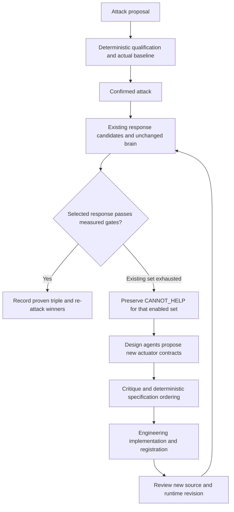

# Verification loop: changes in the boss's Revision 4 package

**Comparison date:** 11 October 2026 (UTC).  
**Scope:** the complete revised architecture DOCX and all seven revised Markdown workstreams, compared with the previously supplied package and our agentic workflow V4.  
**Disposition:** requirements comparison complete; this document is not a live-run verdict or an implementation acceptance.

## 1. Main finding

Revision 4 makes **new-actuator design an explicit continuation of the competition**. A confirmed attack that no existing enabled actuator can defend must generate a bounded design round and an engineering handoff. The loop no longer treats the available actuator list as its final design boundary.

Design agents propose specifications, not executable changes. Engineers implement and register the proposed actuator; the unchanged brain then evaluates it through the same selection, containment, availability and clean-control requirements. Attack agents re-attack the resulting defended state. A new actuator receives no special success exception.

The DOCX's three gates and four scores are unchanged from the original DOCX. Several workstreams have now been corrected to match that contract. Consequently, the package contains both a genuine architecture addition and substantial reconciliation of the earlier supporting documents.

**Version distinction:** the boss's **Revision 4** is a revision of the requirement package. Our **agentic workflow V4** is a separate implementation-design version. Equal version numbers do not establish that our current design incorporates the new package.

## 2. The new actuator-design branch

The authoritative addition is in DOCX **§3.4** and **§7.3**, with supporting detail in WS-1 **§(b), Design roster** and WS-3 **§2B**.

The diagram's engineering review and revision transition make the handoff operationally explicit; they do not assert that an existing implementation already performs it. Missing baseline or effect evidence remains an incomplete observation, rather than proof that every actuator is incapable.

### Design roles

Design proposers are instantiated at the enforcement levels applicable to the uncontained attack:

| Enforcement level | Example responsibility stated by the new requirement |
| --- | --- |
| Network/dataplane | CNI, eBPF and terminating established flows, rather than only blocking new connections |
| Kubernetes platform | Workload or platform enforcement |
| AI/GPU serving | Serving or device-context enforcement |
| Credential | Removing the attacker's credential capability |
| Process | Removing a process-level capability |
| Artifact | Removing an artifact-level capability |

These are conditional personas, not six permanent workers for every workload. Validator personas provide criticism. Deterministic aggregation orders specifications; agreement does not approve a design or prove its effectiveness.

The designers seek the lowest enforcement level that genuinely removes the exploited capability. Each specification must contain an **Actuator Capability Contract**:

1. The attacker capability to remove.
2. Exact cover keys the actuator may claim.
3. The enforcement mechanism.
4. Required RBAC and other permissions.
5. The capability check for this cluster.
6. A deterministic effect-confirmation probe.
7. Availability impact and rollback.
8. A determinism statement.

**A specification without a named effect-confirmation probe is rejected.** It is not placed at the bottom of the ranking and later treated as usable.

### Engineering boundary

The new DOCX explicitly separates specification designers from AI/platform engineers. Design agents must not write, compile or deploy actuator code or change the brain. Their deliverable is a ranked specification list.

An implementation engineer is a separate role with separate authority and review. The requirement does not establish that engineers must be humans; it does establish that the design role itself cannot perform implementation. Any engineering-agent automation must make that role, its tools, scope, source revision and independent review explicit.

After implementation and registration, the new actuator becomes an ordinary enabled candidate. It must be selected normally, prove containment and availability, pass the clean control, and survive re-attack. A failed new implementation preserves an honest failure; the design branch expands the candidate set rather than weakening the gates.

## 3. What changed in each supplied file

| Source | Material changes from the originally supplied version |
| --- | --- |
| Architecture DOCX | Adds the design branch in §§3.4 and 7.3; adds the design/build/re-entry path to the main diagram; adds conditional design-roster sizing in §4.2; adds an explicit §19 approval and first-competition scope section. Its revision paragraph changes. Outside formatting, the rest of the DOCX's substantive text is unchanged, including §8's seven metrics. |
| WS-1: scan/sizing | Adds conditional design seats: `R = G + Val + Des`. Moves numeric-parameter ownership from a separate math referee to logged runtime configuration/policy. The twelve scan dimensions and stable-owner application unit remain. |
| WS-2: generator | Makes the adaptive competition explicit: later rounds target the winning actuator set; the generator interface includes `winningActuators`; the ledger records exact explanations and seven-field verdicts. Quarantined fragments are re-evaluated every round. Numeric settings are configuration, while reachability horizon/decay are fixed invariants. The C1–C6 definitions remain substantively unchanged. |
| WS-3: validator/rubric | Replaces its old five-axis rubric with the DOCX's three gates plus four measured scores. Adds the design-contract and engineering-handoff branch. Makes co-tenant availability and unknown-gate blocking explicit, and removes an asserted illustrative actuator ranking in favour of measured qualification. |
| WS-4: consensus | Focuses on proposal, critique, merge, deterministic ranking and a send queue within each team. Explicitly calls for diverse personas and underlying models, preserves evidence-bearing minorities, and feeds exact decline reasons back into generation. Test ordering is distinct from winner acceptance. Confirmed winners are ranked by dwell first rather than the old blast-radius ordering. |
| WS-5: brain-in-loop | Uses one twin spanning a competition's rounds; adds the matched clean control; removes dispatch-only success and `already-satisfied` defense credit. Adds round identity to the verdict wrapper and distinguishes invalid-trace integrity failures from input-fidelity failures. |
| WS-6: RL hook | Describes proven `(attack, actuator, brain-verdict)` triples with exact explanations and seven metric fields in a customer-scoped shadow learning record. Requires externally confirmed observations. Clarifies that existing red-team RL is generator learning, without asserting that its output is already connected to the competition queue. No new calibration algorithm is introduced. |
| WS-7: external survey | Reconciles the survey to the DOCX: scan-sized rosters, agreement as ordering only, mandatory minority testing, native graph representation and explicit non-transferable fidelity results. Adds a self-play lesson labelled unverified. The bibliography and reported benchmark figures are unchanged. |

All eight raw files changed. A changed file hash does not imply all its substantive requirements changed. In particular, the original DOCX already included consensus, despite the new changelog describing that as a Revision 3 addition.

## 4. Success criteria remain strict

| Field | Required meaning |
| --- | --- |
| G1: defense effect | The attacker capability is observably gone, and the attack's relevant graph edge is removed. |
| G2: availability | Feasibility, the applicable Zero/Bounded availability proof and ledger hold pass for affected workloads; protected co-tenants remain unchanged. |
| G3: clean control | The candidate actuator is not selected in the matched no-attack control. |
| S1: dwell | Measured time from attack onset to capability removal; the primary ranking key. |
| S2: collateral | Measured disruption to non-target workloads. |
| S3: durability | Measured persistence of containment over the configured hold window. |
| S4: cost | Actual measured cost compared with the brain's predicted cost and the applicable rotation baseline. |

The four rules remain: metrics cannot promote an action the brain did not select; missing measurements are unknown rather than zero; competition-derived learning stays in the governed shadow path; and the brain's explanation is quoted exactly.

Phase 1 remains the competition driver, G1–G3 and S1. Phase 2 adds S2–S4. Every metric field remains present; unmeasured secondary values remain explicitly unknown. Dwell is fixed as the primary ranking key; the secondary precedence is configured and logged, with the supplied ordering durability → collateral → cost as the documented order.

No new numerical defaults or measured acceptance thresholds are supplied. No guarantee of a 100-item catalogue or optimal architecture follows from agent count. Stability is relative to the actual tested scope, completed re-attack round and budget.

## 5. Changes needed in our agentic design

Our current V4 already separates attack reality from response success, requires actual effect/availability evidence and clean controls, preserves winners across rounds, rejects incomplete evidence, and supports independent repeat and cleanup. Those parts need no conceptual restart.

| Required revision | Reason |
| --- | --- |
| Update source precedence, hashes and requirement traceability to the new package | The current accepted V4 records bind the previous package, not these eight new files. |
| Separate existing-response proposal, new-actuator specification design and engineering implementation | Current ACTUATOR responsibilities combine design and implementation; the revised package separates them. |
| Add explicit `CANNOT_HELP → DESIGN → ENGINEERING_HANDOFF → REVIEWED_REENTRY` states | An enabled-set refusal must remain in the audit while the larger synthesis workflow continues. Waiting for a build must not be called completion or defense. |
| Include conditional design work in roster, concurrency, token and physical-resource accounting | Design demand is scan/attack-derived rather than an uncounted side task. Logical role count is distinct from simultaneous worker count. |
| Bind winner-targeted generation and every-round quarantine refresh in typed contracts | The revised workstreams specify both the target set and refresh cadence. |
| Record persona/model assignment and diversity limitations | The requirement calls for model diversity. The current owner instruction specifies GPT-6.1 Sol; a Sol-only trial must not claim a mixed-model experiment. |
| Bind verdict wrappers to competition, round, tick and asset; name integrity errors separately | The revised WS-5 makes these distinctions explicit. Native production trace schemas need not be rewritten for wrapper metadata. |
| Regenerate and independently review the portable manual | The manual must reflect the new roles, transitions and provenance without rewriting accepted historical records. |

The intended role separation is: **ACTUATOR** proposes existing responses; **DESIGN** emits capability-contract specifications; **ENGINEER** implements an approved specification under separate authority; **REVIEW** independently evaluates the changed implementation; **EXECUTOR** performs admitted physical work; **METRICS** evaluates original evidence. These are logical jobs, not a requirement to keep that many processes running.

## 6. Remaining tensions in the boss's package

The revised package is clearer, but it is not internally contradiction-free. The operational architecture must state the following interpretations explicitly.

| Source tension | Operational interpretation |
| --- | --- |
| DOCX §3.2 still describes CANNOT_HELP as terminal, while §§3.4/7.3 continue to design. §15's implementation table also omits the new branch. | Preserve a terminal result for the **current enabled actuator set**, then continue the larger program through a bounded design/engineering handoff and a new reviewed revision. |
| WS-1 adds `R = G + Val + Des` but retains `R = G + Val` below it. | The latter is the baseline roster; the former is total conditional demand. Designers, critics and engineering jobs still consume actual scheduling budgets. |
| The package says fully automated with only final approval human, while the new design stage hands work to engineers. | Model engineering as an explicit handoff or separately authorized engineering role, never an invisible side effect of a design prompt. |
| Brain/twin passages still discuss simulated dispatch, while the success rules require measured effect. | Shadow replay establishes selection and determinism; a separately admitted physical execution supplies containment and availability evidence. Replay alone cannot prove effect. |
| First confirmed winner permits early stopping, while evidence-bearing minorities must be tested. | Generation/deliberation may stop; pending mandatory tests remain accounted for. Do not declare STABLE while required test obligations are unfulfilled. |
| Unknown or uncorrelated observations appear alongside CANNOT_HELP examples. | Unknown blocks acceptance. It does not prove a genuine absence of defending actuators and cannot supply a falsely completed design trigger. |
| Competition learning is described as shadow-only while WS-6 also describes existing production RLS updates. | Keep competition-derived proposals separate from the existing normal production calibration path and its controls. |
| WS-6 cites loss-history storage as if it established the larger triple store. | Existing immutable-storage primitives do not by themselves implement the exact-verdict/seven-metric triple schema. That enlarged record requires its own contract and acceptance. |
| WS-7 rejects mandatory ATT&CK labels in its native-graph reconciliation but retains them in a consolidated lesson. | Follow the declared DOCX precedence and native facts/edges; optional analysis labels cannot replace grounding. |
| Code citations and examples describe repository/runtime properties that can change. | Treat them as supplied provenance to recheck at the actual pinned revision, not current deployment attestation. |

## 7. Consequence for the current trial

No new physical V4 trial has been launched during this comparison. It supplies no new defended verdict, and a document review is not a full verification-loop execution.

The held restricted-policy pilot can still produce a useful scoped negative diagnostic. However, a negative-only result would **not** complete the revised actuator-synthesis workflow. A genuine uncontained attack must receive the new design output and engineering handoff; an implemented candidate must then return to actual unchanged-brain evaluation, measured gates, re-attack and independent repeat before a full positive-loop report is justified.

The comparison therefore requires targeted architecture and prompt changes, not a claim that the existing trial already meets Revision 4. Historical accepted documents, failures and reviews remain intact.

## 8. Exact revised source inventory

These hashes identify the eight raw files reviewed. File names, section references and hashes make this report understandable without access to the author's server.

| Revised file | SHA-256 |
| --- | --- |
| `Phorvex-Verification-Loop-Architecture-Rev4 (2).docx` | `734d499a8a08b7ad47fdea97c8c510f321a479607f86ad4467c1a36d7ccf46c9` |
| `WS-1-scan-sizing (1).md` | `fc62f4212a1bd2d8ac9cb682af4f71dc29180ed0ccc460ebcf61fb730ab33c70` |
| `WS-2-generator.md` | `fb5da1e161a4c449ca68768f86f9d588ac473c73ecec879705d779435e261881` |
| `WS-3-validator-rubric (1).md` | `f5192fe92d988998de5bb1549c2d7913d6edb146d9cbe5d0334aeb61f5e55cb8` |
| `WS-4-consensus.md` | `45f4bab37602b09d8dfc5d580d2b6f3727b979e1991b026aa83bc4c866de1335` |
| `WS-5-brain-in-loop.md` | `58742302996f5151fdf6496bab7340944e2f3b7ef3af25c119fe025ec87b0f8c` |
| `WS-6-rl-hook.md` | `0d8bcabb03d70b5e266ddde7d30d804d16babf87c781d1aac4699d9345f8aa05` |
| `WS-7-external-sota.md` | `510afb8182f17bbbf12274c234f694a05bf7acd2645fa88e8c08d128385a6309` |

The original architecture DOCX hash is `0212b45c2ed5bcecdb24b0bb198a837bd8dd7ce74629a8fd0858694b311225ff`. Four parallel GPT-6.1 Sol readers covered the complete revised workstreams, including a second complete DOCX reading; the orchestrator also compared the DOCX and integrated their file-specific findings. External survey claims were compared as supplied; this task did not independently re-validate the cited literature or treat its benchmark claims as our results.
