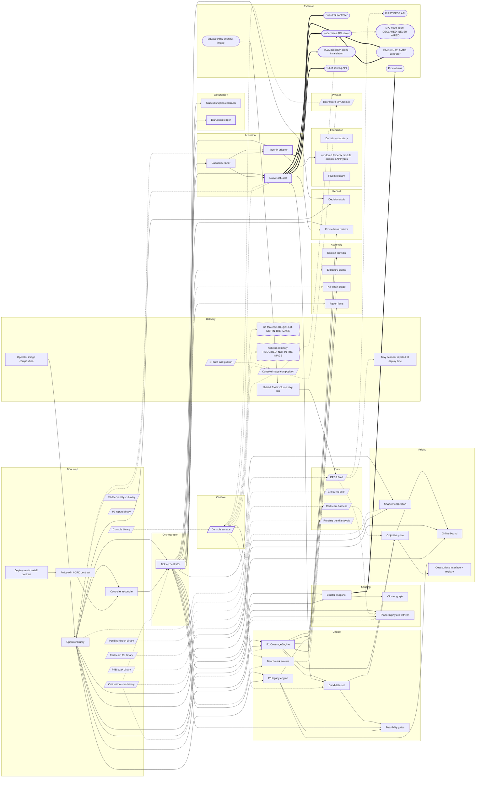

# Phorvex Anatomy v2

**What the parts are, what each is responsible for, which code it owns, how they connect — and
what actually happens when it acts.**

**Source pin:** `fb52e6c976df` (v0.4.64) · **Frozen:** bus 223 · **Anchors verified:** 226
**Companion to:** `../issues/MASTER_ISSUES.md` (what is wrong, joined to this map) and
`pipeline/STATE.md` (how to rebuild and re-verify it).

> **This document is generated**, from two kinds of evidence and nothing else.
>
> 1. **Read out of the frozen inventories** at build time — every count, node, relation,
>    operation row, seam and anchor. If it cannot be read out of NODES / RELATIONS / SEAMS /
>    OPERATION_MATRIX / SOURCE_PIN, it is not here.
> 2. **Quoted from the source at the pin** — the prose in *What Phorvex is* and *Glossary*.
>    Each carries the lines it is quoted from, and the phrases that carry the claim are
>    re-checked against those lines on every rebuild, so a source edit that changes the
>    meaning fails the build.
>
> One entry in the glossary is derived from this map rather than quoted, and labels itself.
> Rebuild with `python3 build_anatomy_doc.py`.

---

## What Phorvex is

*Each statement below is a quotation from the source at the pin. The phrases that carry the claim are re-checked against the cited lines when this file is rebuilt, so a source edit that changes the meaning fails the build rather than leaving a sentence its anchor no longer supports.*

- Phoenix can act on a workload — delete, quarantine, probe — but decides **blindly**: by a clock or a hand-written exact-match table, with no notion of what a move costs or what is worth protecting.
  `README.md:3-4`
- **Phorvex is the missing brain.** It decides *which* workload to move, *when*, and *which action*, by optimizing security gained against disruption cost — then drives Phoenix through Phoenix's own CRDs.
  `README.md:5-8`
- The objective is **maximize E[security] − λ · E[switching-cost]**.
  `api/v1alpha1/phorvexpolicy_types.go:60-61`
- The production decision engine is the **CoverageEngine**: it maximizes consequence-weighted recon-facts-invalidated-per-dollar — Σ w(facts covered by S) − λ·C(S) — by a submodular greedy over the dynamically generated feasible action set, under a one-move-per-asset partition constraint and the move budget. It is **stateful across ticks**.
  `internal/decision/coverage.go:22-27`
- The `proactiveFloor` — the hygiene floor — is a **detection-independent MAXIMUM exposure**: a pod unchanged for longer than `ProactiveFloor` is eligible for a proactive rotation *regardless of any detector*.
  `api/v1alpha1/phorvexpolicy_types.go:204-207`
- Everything is **per tenant**, and a tenant is a namespace (or a vcluster projected as one). The decision engine, exposure clocks, move budget, metrics and actuation are all keyed by it.
  `api/v1alpha1/phorvexpolicy_types.go:11-15`
- **Exposure clocks** track, per mutable VARIABLE of a workload — pod identity, node placement, image, env, GPU binding, network identity, session — the time since that variable last changed.
  `internal/exposure/clock.go:6-9`
- Two run modes: `dryRun` decides, logs and emits metrics but **never actuates** (the default), and `active` additionally drives Phoenix.
  `api/v1alpha1/phorvexpolicy_types.go:387-390`
- Which hands it uses is one environment variable: `PHORVEX_ACTUATOR=native` selects the native actuator, and unset selects the **Phoenix adapter**, the default, which drives unmodified Phoenix. Both satisfy the same interface — the brain does not change.
  `internal/runner/manager.go:140-143`

So the shape of the thing is: **watch a tenant, price every move it could make, pick the set that buys the most security per unit of disruption, and enact it — on a floor that fires whether or not anything was detected.** The lanes below are that sentence, in order.

## On the name

v1 described Phorvex as 12 subsystems and 23 interactions. This map is **99 nodes in 15 lanes, 111 relations, 8 seams and 114 operations** over the same product.

The difference is not detail for its own sake. **A node is not a package.** The `cost` package
is 4 nodes, `console` is 8, `runner` is 8 — because the package boundary is not
the responsibility boundary, and an issue lands on a responsibility. The finest grain here is
one row per static call site, which is what lets the map say *which object gets which verb* and
*whether that call site runs at all*, instead of naming a subsystem and stopping.

## How to read this

The anatomy has four kinds of statement, and they carry different weight.

- **Nodes** are the parts. Each owns specific files and carries a line anchor into the code that
  defines it. A node is not a package: `cost` is four nodes, `console` is eight, because the
  package boundary is not the responsibility boundary.
- **Relations** are how parts reach each other, each anchored at the call site that proves it.
- **Seams** are contracts that are stated but not kept. Each carries *contract evidence* (where
  the promise is made) and *negative evidence* (where it is not honoured).
- **Operations** are the finest grain: one row per static call site in the actuation surface,
  saying which object gets which verb, whether that call site runs in the shipped binary, and
  what — if anything — confirms it worked.

Where this document says something is *not confirmed*, that is a statement about the code, not a
hedge about the analysis.

### The confirmation vocabulary

Six different things get called "it worked". They are closed tokens here, and they are not
interchangeable — most of this map's findings live in the gaps between them.

| token | what it actually establishes |
|---|---|
| `write-ack` | the API server stored the object. Nothing about effect. |
| `protocol-ack` | a serving stack answered the request. Stronger than a store; still not the outcome. |
| `independent readback` | a later read confirms the resulting state. Present nowhere in this surface. |
| `availability / recovery` | something observed the workload return. One action has this, conditionally. |
| `security-goal confirmation` | evidence the security outcome occurred. Zero operations have it. |
| `runner ledger` | what the operator RECORDS happened — an outcome name, not an observation. |

Two more tokens qualify every operation:

- **`crossing_status`** — is the destination wired at all: `implemented` | `declared-unwired` |
  `absent-stub`. A named controller is not a reachable one.
- **`shipped_reachability`** — does THIS call site execute in the shipped binary: `reachable` |
  `guarded-unreached` (a guard above it always fails) | `tool-only` (invoked only from a
  one-shot tool). The destination being wired says nothing about the call site running.

### How the issue register points here

`PHORVEX_MASTER_ISSUES_V2.md` joins each live issue to this map in one of three classes:

- **`located-at`** — the map holds the thing the issue is about.
- **`affects`** — the defect is below operation granularity: the contents of a call, or a pure
  helper that performs no operation. The map is not required to have a row for every payload
  field.
- **`absence`** — the issue names something that is not there, so it has no positive locus.

The pointer is **one-way**. The register cites this file; closing an issue does not edit it.

## The tick

One pass of the operator loop, read out of `runner` and its outbound relations. The numbered steps are the **production-role** edges only. Six edges run inside this same pass carrying a non-production role; they are footnoted rather than numbered, so the sequence stays the one the shipped production path takes and nothing same-pass goes unmentioned:

1. `runner.killswitch` → `runner.tick` — gates the tick · `manager.go:270`
2. `runner.tick` → `metrics` — writes · `manager.go:271`
3. `runner.tick` → `ingest` — calls · `manager.go:304`
4. `runner.tick` → `runner.feedback` — calls-before-decide · `manager.go:320`
5. `runner.tick` → `platform` — calls · `manager.go:324`
6. `runner.tick` → `runner.assembly` — per-tenant loop · `manager.go:332`
7. `runner.feedback` → `metrics` — records rotation outcome · `manager.go:523`
8. `runner.feedback` → `cost.rls` — observes · `manager.go:599`
9. `runner.assembly` → `exposure` — reads · `manager.go:783`
10. `runner.assembly` → `ingest` — reads pod phase · `manager.go:825`
11. `runner.assembly` → `decision.coverage` — calls · `manager.go:852`
12. `runner.assembly` → `decision.p0` — calls · `manager.go:852`
13. `runner.emit` → `actuator.router` — calls · `manager.go:904`
14. `runner.emit` → `feasibility` — re-checks at the emit boundary · `manager.go:904`
15. `runner.assembly` → `runner.emit` — conditional on a selected move · `manager.go:904`
16. `runner.tick` → `audit` — writes · `manager.go:909`
17. `runner.assembly` → `metrics` — publishes per-tick metrics · `manager.go:928`

*Not per-tick, and listed here so they are not mistaken for steps:*

- `runner.emit` → `actuator.native` — selects (PHORVEX_ACTUATOR=native) · `internal/runner/manager.go:146`
- `runner.emit` → `actuator.phoenix` — selects (default) · `internal/runner/manager.go:153 default -> NewPhoenixActuator`
- `runner` → `recon` — startup validation · `internal/runner/manager.go:208`

*Same pass, not production-role — these run inside this loop but are not steps of the production path:*

- `runner.tick` → `calib` — calls · *shadow* · `manager.go:326`
- `runner.feedback` → `calib` — ObserveRotation · *shadow* · `manager.go:388`
- `runner.feedback` → `slo.contract` — reads · *observe-only* · `manager.go:453`
- `runner.assembly` → `runner.shadow_validation` — invokes · *observe-only* · `manager.go:866`
- `runner.shadow_validation` → `feasibility` — evaluates the gate on shadow decisions · *observe-only* · `manager.go:998`
- `runner.feedback` → `slo.ledger` — writes · *observe-only* · `manager.go:1074`

## The map

The picture above is `generated/ANATOMY.mmd` verbatim (top-level nodes and their
wiring). **`generated/ANATOMY-map.pdf` is that same source rendered by mermaid** — one vector page, and
the copy to read if your viewer does not draw mermaid; regenerate it with
`pipeline/render_diagram.sh`. `generated/ANATOMY.svg` is a third view: the full inventory
with all 39 children drawn as cards. All three come from these same inventories. Shapes carry facts: a slanted box is off the decision path, a rounded box is a
system Phorvex does not own, a dashed outline is declared-but-never-wired, a bold border means
the node carries a seam, and a thick arrow is a crossing out of the cluster.

99 nodes in 15 lanes, 111 relations, 8 seams, 1 intentional boundary.

### Foundation — shared types and registries every other lane compiles against

*3 nodes · 561 LOC*

- **`model`** — Domain vocabulary · *foundation*
  fan-in 19/28; imports nothing internal
  `internal/model/types.go:120`
- **`phoenix.module`** — vendored Phoenix module (compiled API/types) · *foundation*
  phorvex/go.mod:79 replaces github.com/r6security/phoenix with it, so its API/types are COMPILED IN; distinct from ext.phoenix, the separately running controller
  `build/phoenix-extended/go.mod:1`
- **`registry`** — Plugin registry · *foundation*
  registry.go doc: PhysicsProfile/FeasibilityConstraint/CostModel/BeliefEstimator/ContextProvider
  `internal/registry/registry.go:32`

### Bootstrap — process entry, flag parsing, and the contracts the cluster validates against

*11 nodes · 2,148 LOC*

- **`api.v1alpha1`** — Policy API / CRD contract
  ActionType enum, 17 values = the 16 registered handlers + noop (no handler). v0.4.59-64 CLOSED the old 12-vs-15 vocabulary gap; a schema contract, not on either engine path
  `api/v1alpha1/phorvexpolicy_types.go:359`
- **`cmd.calib_soak`** — Calibration soak binary · *tool*
  separate main package; not the operator binary
  `cmd/calib-soak/main.go:41`
- **`cmd.console`** — Console binary · *tool*
  separate main package; not the operator binary
  `cmd/console/main.go:23`
- **`cmd.main`** — Operator binary
  the operator entrypoint: scheme/flags/manager wiring, engine and actuator selection, one-shot modes
  `cmd/main.go:54`
- **`cmd.p3deep`** — P3 deep-analysis binary · *tool*
  separate main package; not the operator binary
  `cmd/p3deep/main.go:41`
- **`cmd.p3report`** — P3 report binary · *tool*
  separate main package; not the operator binary
  `cmd/p3report/main.go:101`
- **`cmd.p4b_soak`** — P4B soak binary · *tool*
  separate main package; not the operator binary
  `cmd/p4b-soak/main.go:28`
- **`cmd.pendingcheck`** — Pending-check binary · *tool*
  separate main package; not the operator binary
  `cmd/pendingcheck/main.go:13`
- **`cmd.redteam`** — Red-team RL binary · *tool*
  separate main package; not the operator binary
  `cmd/redteam-rl/main.go:53`
- **`controller`** — Controller reconcile
  imports runner; cmd-attached
  `internal/controller/phorvexpolicy_controller.go:38`
- **`deploy`** — Deployment / install contract
  RBAC role + Helm chart; first apiGroups rule block
  `config/rbac/role.yaml:13`

### Orchestration — the tick loop: what runs, in what order, per tenant

*6 nodes · 1,972 LOC*

- **`runner`** — Tick orchestrator
  Manager.tick manager.go:255; 14 internal imports
  `internal/runner/manager.go:113`
    - `runner.assembly` — Per-tenant WorkloadView · `internal/runner/manager.go:747`
      processTenantWithPhysics; WorkloadView built at :822
    - `runner.emit` — Emit-boundary safety · `internal/runner/manager.go:1061`
      kill switch + dry-run + actuation orchestration
    - `runner.feedback` — Rotation feedback · `internal/runner/manager.go:483`
      :320 observeReadyRotations :381 trackRotationWithFloor :449 recordActionOutcome :483
    - `runner.killswitch` — Kill switch · `internal/runner/killswitch.go:30`
      KillSwitch.Engaged read at manager.go:270; CalibrationFrozen at :277; own file, state and failure semantics
    - `runner.policies` — Tenant policy registry · `internal/runner/manager.go:105`
      manager.go:105 policies map; :158 Upsert
    - `runner.shadow_validation` — Shadow decision validation · *observe-only* · `internal/runner/manager.go:982`
      shadowSafetyViolations (982-1010), called at :866; compares shadow decisions against the availability and SLO gates.
    - `runner.tick` — Snapshot + scheduling · `internal/runner/manager.go:255`
      manager.go:255

### Sensing — what the operator can see about the cluster and the workload

*3 nodes · 2,312 LOC*

*Crosses out of process or out of the cluster 1 time:*
- `ingest` → `ext.prometheus` — queries telemetry

- **`graph`** — Cluster graph
  imported by ingest/kube.go only
  `internal/graph/reachability.go:33`
- **`ingest`** — Cluster snapshot
  ingest.CollectSnapshot, PopulateGPUWitness
  `internal/ingest/kube.go:89`
- **`platform`** — Platform physics witness
  platform.Derive(snap) once per tick, shared
  `internal/platform/platform.go:50`

### Assembly — turning observations into the view a decision is made on

*4 nodes · 1,544 LOC*

- **`ctxprov`** — Context provider
  coverage.go: 2 refs; ALSO a P0 decision input — engine.go:87 resolves it, :128 calls it
  `internal/ctxprov/sensed.go:45`
- **`exposure`** — Exposure clocks
  persistent cross-tick state + own retention lifecycle
  `internal/exposure/clock.go:47`
- **`killchain`** — Kill-chain stage
  coverage.go: 5 refs; hazard.go:34-35 nine stages
  `internal/killchain/hazard.go:49`
- **`recon`** — Recon facts
  coverage.go: 9 refs
  `internal/recon/ucw.go:46`

### Pricing — what an action is judged to cost

*4 nodes · 3,072 LOC*

- **`calib`** — Shadow calibration · *shadow*
  runtime.go:34 learned values never enter production scoring
  `internal/calib/runtime.go:48`
- **`cost.p1`** — Objective price
  coverage.go: 17 cost. refs
  `internal/cost/p1cost.go:33`
- **`cost.rls`** — Online bound
  phorvex_rls_* gauges
  `internal/cost/rls.go:27`
- **`cost.surface`** — Cost surface (interface + registry) · *foundation*
  CostModel interface + Registry; P0 resolves through cost.Registry.Default() at decision/engine.go:81, P1 uses the concrete P1Cost
  `internal/cost/model.go:21`

### Choice — the decision engines that select actions

*8 nodes · 3,130 LOC*

- **`actionset`** — Candidate set
  coverage.go: 5 refs; the only actionset mention in engine.go is a COMMENT at :101, not a call
  `internal/actionset/generator.go:57`
- **`decision.bench`** — Benchmark solvers · *benchmark*
  coverage.go refs: 0; reached from console/benchmark_sim.go, runner/ablation_run.go, cmd/main.go
  `internal/decision/localsearch.go:31`
- **`decision.coverage`** — P1 CoverageEngine
  Name()="p1-coverage" coverage.go:133; owns optimizer.go (the Optimizer interface both engines implement)
  `internal/decision/coverage.go:133`
- **`decision.p0`** — P0 legacy engine
  Engine="p0-greedy" engine.go:197; engine.go:151 is switching's only caller
  `internal/decision/engine.go:197`
    - `belief` — Belief estimator · `internal/belief/reconexposure.go:29`
      sole importer decision/engine.go
    - `cost.switching` — Switching cost · `internal/cost/switching.go:27`
      sole caller engine.go:151; p1cost.go:299 has its own
    - `physics` — Physics residual · `internal/physics/littleslaw.go:29`
      sole importer decision/engine.go
- **`feasibility`** — Feasibility gates
  coverage.go: 1 ref
  `internal/feasibility/defaults.go:24`

### Actuation — the hands: the actuators and their handlers

*20 nodes · 252 LOC*

*Crosses out of process or out of the cluster 6 times:*
- `actuator.native.handlers` → `ext.guardrail` — guardrail variant rotation
- `actuator.native.handlers` → `ext.k8s` — MIG node-agent exec goes through the API server
- `actuator.native.handlers` → `ext.kv_local` — local KV cache invalidation
- `actuator.native.handlers` → `ext.vllm` — serving-API calls
- `actuator.phoenix` → `ext.k8s` — maintains the AMTD strategy CR
- `actuator.phoenix` → `ext.k8s` — writes the SecurityEvent

- **`actuator.native`** — Native actuator
  native.go:44 -> dispatch -> 16 HandlerRegistry registrations
  `internal/actuator/native.go:44`
    - `actuator.native.handlers` — Native handlers (16) · `internal/actuator/handler.go:53`
      16 HandlerRegistry.Register calls; each a Go type with Name() at a fixed line
        - `actuator.native.adapter-rotate` — adapter-rotate handler · `internal/actuator/handlers_ai_p4set.go:156`
          adapterRotateHandler; in model.MutatingActions
        - `actuator.native.custom-inject` — custom-inject handler · `internal/actuator/handlers_k8s.go:210`
          customInjectHandler; in model.MutatingActions
        - `actuator.native.debugger` — debugger handler · `internal/actuator/handlers_k8s.go:200`
          debuggerHandler; in model.MutatingActions
        - `actuator.native.disable` — disable handler · *unwired* · `internal/actuator/handlers_k8s.go:253`
          disableHandler; NOT in model.MutatingActions
        - `actuator.native.endpoint-rotate` — endpoint-rotate handler · `internal/actuator/handlers_ai.go:319`
          endpointRotateHandler; in model.MutatingActions
        - `actuator.native.guardrail-rotate` — guardrail-rotate handler · `internal/actuator/handlers_ai_p4set.go:306`
          guardrailRotateHandler; in model.MutatingActions
        - `actuator.native.identity-rotate` — identity-rotate handler · `internal/actuator/handlers_k8s.go:271`
          identityRotateHandler; in model.MutatingActions
        - `actuator.native.kv-migrate-invalidate` — kv-migrate-invalidate handler · `internal/actuator/handlers_ai_p4set.go:385`
          kvMigrateInvalidateHandler; in model.MutatingActions
        - `actuator.native.kv-reset` — kv-reset handler · `internal/actuator/handlers_ai.go:275`
          kvResetHandler; in model.MutatingActions
        - `actuator.native.mig-rebind` — mig-rebind handler · `internal/actuator/handlers_ai.go:212`
          migRebindHandler; in model.MutatingActions
        - `actuator.native.model-shard-replace` — model-shard-replace handler · `internal/actuator/handlers_ai.go:368`
          modelShardReplaceHandler; in model.MutatingActions
        - `actuator.native.quarantine` — quarantine handler · `internal/actuator/handlers_k8s.go:80`
          quarantineHandler; in model.MutatingActions
        - `actuator.native.request-drain` — request-drain handler · `internal/actuator/handlers_ai_p4set.go:257`
          requestDrainHandler; in model.MutatingActions
        - `actuator.native.rotate` — rotate handler · `internal/actuator/handlers_k8s.go:45`
          rotateHandler; in model.MutatingActions
        - `actuator.native.route-rotate` — route-rotate handler · `internal/actuator/handlers_k8s.go:309`
          routeRotateHandler; in model.MutatingActions
        - `actuator.native.warm-swap` — warm-swap handler · `internal/actuator/handlers_ai.go:204`
          warmSwapHandler; in model.MutatingActions
- **`actuator.phoenix`** — Phoenix adapter
  phoenix.go:44; Client.Create(ctx, se) at :140 then Emitted:true at :150
  `internal/actuator/phoenix.go:44`
- **`actuator.router`** — Capability router
  hybrid.go:44; Actuate routes on RuleTypeFor(action)!=""
  `internal/actuator/hybrid.go:44`

### Observation — what is measured about what happened

*4 nodes · 812 LOC*

- **`slo.contract`** — Static disruption contracts · *observe-only*
  slo.Classify used only at manager.go:420,425,453,1093 for outcome evidence
  `internal/slo/contract.go:72`
- **`slo.ledger`** — Disruption ledger · *observe-only*
  OutcomeCompleted/Failed/Emitted; no consumer in coverage.go
  `internal/slo/ledger.go:113`

### Record — what is written down

*2 nodes · 744 LOC*

- **`audit`** — Decision audit
  log.go:25-86 Record struct
  `internal/audit/log.go:25`
- **`metrics`** — Prometheus metrics
  fan-in 3
  `internal/metrics/metrics.go:152`

### Console — the operator-facing surface; off the decision path, which is not the same as read-only

*9 nodes · 18,981 LOC*

*Crosses out of process or out of the cluster 6 times:*
- `console.attack` → `bin.go_toolchain` — execs `go test` for the policy suite
- `console.attack` → `bin.kubectl` — execs kubectl to apply a SecurityEvent CR
- `console.attack` → `bin.redteam_rl` — execs the RL trainer binary
- `console.bench` → `bin.harness` — execs the harness to enumerate the catalogue
- `console.live` → `bin.phorvex_cli` — execs the operator binary for --scan
- `console.runs` → `bin.harness` — execs the harness to run a scenario

- **`console`** — Console surface · *tool*
  cmd-attached; 62 routes, 42 non-test files
  `internal/console/server.go:37`
    - `applier` — CRD policy applier · *unwired* · `internal/applier/crd.go:33`
      patches PhorvexPolicy; cmd/console/main.go:84 NewApplyFixManager(nil,nil,nil)
    - `console.analytics` — Analytics + reporting · *tool* · `internal/console/uptime.go:53`
      /api/cost,pricing,effectiveness,metrics
    - `console.applyfix` — Policy ApplyFix · *tool* · `internal/console/applyfix.go:42`
      gate + two-key; applier nil-injected
    - `console.attack` — Attack surface · *tool* · `internal/console/attack_results.go:126`
      /api/redteam/* 9 routes
    - `console.bench` — Benchmark simulation · *tool* · `internal/console/benchmark_sim.go:143`
      imports decision/localsearch
    - `console.live` — Live cluster reads · *tool* · `internal/console/live.go:31`
      /api/live, /api/cluster, /api/owner/*
    - `console.runs` — Scenario runs · *tool* · `internal/console/runs.go:29`
      /api/runs/* 7 routes
    - `console.server` — HTTP server + identity · *tool* · `internal/console/server.go:37`
      57 of 62 routes; OIDC nil => demo-trust

### Tools — one-shot binaries and analysis paths, not the operator loop

*4 nodes · 2,200 LOC*

*Crosses out of process or out of the cluster 2 times:*
- `epssfeed` → `bin.trivy` — execs the Trivy scanner per image
- `epssfeed` → `ext.first_epss` — resolves CVEs through the FIRST EPSS API

- **`epssfeed`** — EPSS feed · *tool*
  cmd-attached; writes the cache ingest reads
  `internal/epssfeed/feed.go:83`
- **`pendinggate`** — CI source scan · *tool*
  cmd/pendingcheck; imports nothing
  `internal/pendinggate/gate.go:46`
- **`redteam`** — Red-team harness · *tool*
  cmd-attached; imports cost only
  `internal/redteam/autograd.go:21`
- **`soak`** — Runtime trend analysis · *tool*
  cmd/p4b-soak; imports nothing
  `internal/soak/slope.go:25`

### Product — the shipped user-facing surface

*2 nodes · 9,362 LOC*

- **`dashboard`** — Dashboard SPA (Next.js) · *tool*
  the shipped product surface; static-exported by console.Dockerfile stage `web` and served by the console binary at /. runtime_role=tool means "not on the OPERATOR decision path" — it is the shipped observability product, not part of the tick
  `dashboard-web/lib/api.ts:30`
    - `dashboard.api` — console API + SSE client · *tool* · `dashboard-web/lib/api.ts:35`
      every panel reads the console over HTTP; live views hold an EventSource

### Delivery — how the product is composed and reaches a cluster

*10 nodes · 862 LOC*

*Crosses out of process or out of the cluster 1 time:*
- `bin.kubectl` → `ext.k8s` — applies the CR through the API server

- **`bin.go_toolchain`** — Go toolchain (REQUIRED, NOT IN THE IMAGE) · *unwired*
  the console execs `go test`; the final stage is distroless/static:nonroot, which has no Go toolchain
  `internal/console/redteam.go:322`
- **`bin.redteam_rl`** — redteam-rl binary (REQUIRED, NOT IN THE IMAGE) · *unwired*
  the console execs <root>/phorvex/bin/redteam-rl; console.Dockerfile never COPYs it, so the endpoint fails in the shipped image
  `internal/console/redteam.go:60`
- **`bin.trivy`** — Trivy scanner (injected at deploy time)
  the --epss-feed one-shot execs s.Path; the OPERATOR IMAGE does not contain it, but the Helm chart injects it via an aquasec/trivy initContainer into a shared /tools volume (epss-feed.yaml:116-169).
  `internal/epssfeed/sync.go:394`
- **`ci.release`** — CI build and publish · *tool*
  the path by which the modelled console image comes to exist
  `.github/workflows/ci.yml:245`
- **`image.console`** — Console image composition · *tool*
  distroless/static final stage composing SPA + console + phorvex CLI + harness + kubectl into ONE image
  `deploy/docker/console.Dockerfile:118`
    - `bin.harness` — harness binary in the console image · *tool* · `deploy/docker/console.Dockerfile:126`
      its own Go module; the console execs it to enumerate the scenario catalogue
    - `bin.kubectl` — kubectl in the console image · *tool* · `deploy/docker/console.Dockerfile:132`
      pinned + checksum-verified; the console cannot reach pod IPs directly so it shells out
    - `bin.phorvex_cli` — phorvex CLI in the console image · *tool* · `deploy/docker/console.Dockerfile:130`
      the SAME operator module built a second time; the console execs it for --scan.
- **`image.operator`** — Operator image composition
  distroless/static:nonroot with ONLY /manager; the operator ships as a single static binary
  `deploy/docker/operator.Dockerfile:42`
- **`vol.trivy_bin`** — shared /tools volume (trivy-bin)
  an emptyDir the initContainer writes and the feed container mounts read-only — the runtime delivery path the image alone cannot show
  `charts/phorvex/templates/epss-feed.yaml:169`

### External — systems Phorvex does not own, at the point its code crosses into them

*9 nodes*

*Crosses out of process or out of the cluster 3 times:*
- `ext.k8s` → `ext.mig_agent` — DECLARED remotecommand exec into the node-agent (never wired)
- `ext.k8s` → `ext.phoenix` — Phoenix reconciles the CRs Phorvex wrote
- `ext.phoenix` → `ext.k8s` — Phoenix mutates the workload it reconciled

- **`ext.first_epss`** — FIRST EPSS API · *external*
  https://api.first.org/data/v1/epss — the feed resolves CVEs through it; Trivy is not its only external dependency
  `internal/epssfeed/sync.go:35`
- **`ext.guardrail`** — Guardrail controller · *external*
  a DIFFERENT control surface reached over the same httpVLLM transport: POST ep.guardPath {"variant": ...}
  `internal/actuator/gpu_stack_p4set.go:157`
- **`ext.k8s`** — Kubernetes API server · *external*
  boundary: every actuation is a client-go write to the API server
  `internal/actuator/phoenix.go:140`
- **`ext.kv_local`** — vLLM local KV-cache invalidation · *external*
  ONLY the LOCAL invalidate crosses: POST ep.kvInvPath {"local": true}. MigrateRemote is an always-error stub, so cross-worker transfer never crosses a boundary
  `internal/actuator/gpu_stack_p4set.go:183`
- **`ext.mig_agent`** — MIG node-agent (DECLARED, NEVER WIRED) · *unwired*
  the transport exists in source but WireRemoteNodeExec has zero callers, pkgNodeExec stays nil, and no chart deploys a MIG node-agent — declared, not reachable in the shipped product
  `internal/actuator/nodeexec.go:73`
- **`ext.phoenix`** — Phoenix / R6 AMTD controller · *external*
  the EXTERNAL reconciler, anchored in its own source: SecurityEvent Reconcile at :77 and AMTD Reconcile at build/phoenix-extended/internal/controller/adaptivemovingtargetdefense_controller.go:60.
  `build/phoenix-extended/internal/controller/securityevent_controller.go:77`
- **`ext.prometheus`** — Prometheus · *external*
  boundary: telemetry ingest over /api/v1/query; absent = K8s-only signals, never fabricated
  `internal/ingest/prometheus.go:204`
- **`ext.vllm`** — vLLM serving API · *external*
  HTTP control surface: ModelReady/ResetPrefixCache via httpVLLM.do, adapter load/unload and drain via postJSON
  `internal/actuator/gpu_stack.go:133`
- **`image.trivy`** — aquasec/trivy scanner image · *external*
  a third-party image run as an initContainer; it copies its trivy binary into a shared volume for the feed container
  `charts/phorvex/values.yaml:88`

---

## The interactions

All 111 relations, grouped by the lane they leave from. This is the wiring; a count is
not a map. Every row is anchored at the call site that proves it.

### From Bootstrap — 22

| from | to | what | crossing | role | anchor |
|---|---|---|---|---|---|
| `api.v1alpha1` | `controller` | schema |  |  | `internal/controller/phorvexpolicy_controller.go:39` |
| `cmd.calib_soak` | `calib` | runs the shadow calibrator |  | *tool* | `cmd/calib-soak/main.go:144` |
| `cmd.calib_soak` | `platform` | loads the EPSS cache |  | *tool* | `cmd/calib-soak/main.go:127` |
| `cmd.calib_soak` | `runner` | constructs the manager |  | *tool* | `cmd/calib-soak/main.go:150` |
| `cmd.console` | `console` | constructs the server |  | *tool* | `cmd/console/main.go:43` |
| `cmd.main` | `actuator.native` | constructs the native actuator (native-demo one-shot mode) |  | *tool* | `cmd/nativedemo.go:38` |
| `cmd.main` | `actuator.phoenix` | constructs the Phoenix actuator (integration-emit one-shot mode) |  | *tool* | `cmd/main.go:384` |
| `cmd.main` | `audit` | constructs / calls |  |  | `cmd/main.go:272` |
| `cmd.main` | `calib` | runs the shadow calibrator |  | *shadow* | `cmd/main.go:240` |
| `cmd.main` | `controller` | wires |  |  | `cmd/main.go:281` |
| `cmd.main` | `cost.rls` | configures the GPU envelope |  |  | `cmd/main.go:161` |
| `cmd.main` | `decision.coverage` | wires (default engine) |  |  | `cmd/main.go:254` |
| `cmd.main` | `decision.p0` | wires (engine=p0) |  |  | `cmd/main.go:251` |
| `cmd.main` | `epssfeed` | constructs / calls |  | *tool* | `cmd/main.go:337` |
| `cmd.main` | `ingest` | wires the snapshot source |  |  | `cmd/main.go:262` |
| `cmd.main` | `platform` | loads the EPSS cache |  |  | `cmd/main.go:185` |
| `cmd.main` | `runner` | wires |  |  | `cmd/main.go:235` |
| `cmd.p4b_soak` | `soak` | fits the trend model |  | *tool* | `cmd/p4b-soak/main.go:152` |
| `cmd.pendingcheck` | `pendinggate` | runs the source scan |  | *tool* | `cmd/pendingcheck/main.go:24` |
| `cmd.redteam` | `redteam` | constructs env and agent |  | *tool* | `cmd/redteam-rl/main.go:66` |
| `controller` | `runner.policies` | reconcile |  |  | `internal/controller/phorvexpolicy_controller.go:53 + :42` |
| `deploy` | `api.v1alpha1` | installs |  | *infrastructure* | `config/crd/kustomization.yaml:4` |

### From Orchestration — 23

| from | to | what | crossing | role | anchor |
|---|---|---|---|---|---|
| `runner` | `decision.bench` | ablation one-shot |  | *benchmark* | `internal/runner/ablation_run.go:147` |
| `runner` | `killchain` | ablation-mode construction |  | *benchmark* | `internal/runner/ablation_run.go:41` |
| `runner` | `recon` | startup validation |  |  | `internal/runner/manager.go:208` |
| `runner.assembly` | `decision.coverage` | calls |  |  | `internal/runner/manager.go:852 + cmd/main.go:254` |
| `runner.assembly` | `decision.p0` | calls |  |  | `internal/runner/manager.go:852 + cmd/main.go:251` |
| `runner.assembly` | `exposure` | reads |  |  | `internal/runner/manager.go:783 + :799` |
| `runner.assembly` | `ingest` | reads pod phase |  |  | `internal/runner/manager.go:825` |
| `runner.assembly` | `metrics` | publishes per-tick metrics |  |  | `internal/runner/manager.go:928 + :854` |
| `runner.assembly` | `runner.emit` | conditional on a selected move |  |  | `internal/runner/manager.go:1061` |
| `runner.assembly` | `runner.shadow_validation` | invokes |  | *observe-only* | `internal/runner/manager.go:866` |
| `runner.emit` | `actuator.native` | selects (PHORVEX_ACTUATOR=native) |  |  | `internal/runner/manager.go:146` |
| `runner.emit` | `actuator.phoenix` | selects (default) |  |  | `internal/runner/manager.go:153 default -> NewPhoenixActuator` |
| `runner.emit` | `actuator.router` | calls |  |  | `internal/runner/manager.go:1061` |
| `runner.emit` | `actuator.router` | selects (PHORVEX_ACTUATOR=hybrid) |  |  | `internal/runner/manager.go:1061` |
| `runner.emit` | `feasibility` | re-checks at the emit boundary |  |  | `internal/runner/manager.go:1051 feasibility.Evaluate` |
| `runner.killswitch` | `runner.tick` | gates the tick |  |  | `internal/runner/manager.go:270 KillSwitch.Engaged` |
| `runner.tick` | `audit` | writes |  |  | `internal/runner/manager.go:909` |
| `runner.tick` | `calib` | calls |  | *shadow* | `internal/runner/manager.go:326` |
| `runner.tick` | `ingest` | calls |  |  | `internal/runner/manager.go:304` |
| `runner.tick` | `metrics` | writes |  |  | `internal/runner/manager.go:271` |
| `runner.tick` | `platform` | calls |  |  | `internal/runner/manager.go:324` |
| `runner.tick` | `runner.assembly` | per-tenant loop |  |  | `internal/runner/manager.go:332` |
| `runner.tick` | `runner.feedback` | calls-before-decide |  |  | `internal/runner/manager.go:320 observeReadyRotations(snap)` |

### From Sensing — 2

| from | to | what | crossing | role | anchor |
|---|---|---|---|---|---|
| `ingest` | `ext.prometheus` | queries telemetry | `implemented` |  | `internal/ingest/prometheus.go:204` |
| `ingest` | `graph` | calls |  |  | `internal/ingest/kube.go:168 + :146` |

### From Pricing — 2

| from | to | what | crossing | role | anchor |
|---|---|---|---|---|---|
| `cost.p1` | `cost.rls` | reads-bound |  |  | `internal/cost/p1cost.go:260 + :180` |
| `cost.p1` | `cost.surface` | implements |  |  | `internal/cost/p1cost.go:299` |

### From Choice — 15

| from | to | what | crossing | role | anchor |
|---|---|---|---|---|---|
| `actionset` | `cost.p1` | calls |  |  | `internal/actionset/generator.go:199` |
| `actionset` | `feasibility` | calls |  |  | `internal/actionset/generator.go:190` |
| `decision.bench` | `recon` | resolves a recon profile by name |  | *benchmark* | `internal/decision/ablation.go:45` |
| `decision.coverage` | `actionset` | calls |  |  | `internal/decision/coverage.go:228 + :217 (wiring)` |
| `decision.coverage` | `cost.p1` | calls |  |  | `internal/decision/coverage.go:223 + :438` |
| `decision.coverage` | `ctxprov` | calls |  |  | `internal/decision/coverage.go:186` |
| `decision.coverage` | `killchain` | calls |  |  | `internal/decision/coverage.go:192` |
| `decision.coverage` | `metrics` | emits |  |  | `internal/decision/coverage.go:263` |
| `decision.coverage` | `recon` | wires (no call) |  |  | `internal/decision/coverage.go:218 (WIRING ONLY)` |
| `decision.p0` | `belief` | calls |  |  | `internal/decision/engine.go:132` |
| `decision.p0` | `cost.surface` | resolves the cost model |  |  | `internal/decision/engine.go:81` |
| `decision.p0` | `cost.switching` | calls |  |  | `internal/decision/engine.go:151 sole caller` |
| `decision.p0` | `ctxprov` | resolves and calls the context provider |  |  | `internal/decision/engine.go:128 + :87` |
| `decision.p0` | `feasibility` | calls |  |  | `internal/decision/engine.go:154 feasibility.Evaluate` |
| `decision.p0` | `physics` | calls |  |  | `internal/decision/engine.go:124` |

### From Actuation — 12

| from | to | what | crossing | role | anchor |
|---|---|---|---|---|---|
| `actuator.native` | `actionset` | completeness invariant |  |  | `internal/actuator/handler.go:103 + :115` |
| `actuator.native` | `actuator.native.handlers` | dispatch |  |  | `internal/actuator/native.go:82` |
| `actuator.native.handlers` | `ext.guardrail` | guardrail variant rotation | `implemented` |  | `internal/actuator/gpu_stack_p4set.go:157` |
| `actuator.native.handlers` | `ext.k8s` | MIG node-agent exec goes through the API server | `implemented` |  | `internal/actuator/gpu_stack_p4set.go:247` |
| `actuator.native.handlers` | `ext.kv_local` | local KV cache invalidation | `implemented` |  | `internal/actuator/gpu_stack_p4set.go:183` |
| `actuator.native.handlers` | `ext.vllm` | serving-API calls | `implemented` |  | `internal/actuator/gpu_stack.go:133` |
| `actuator.native.handlers` | `metrics` | records drain outcome |  |  | `internal/actuator/handlers_ai_p4set.go:279` |
| `actuator.phoenix` | `ext.k8s` | writes the SecurityEvent | `implemented` |  | `internal/actuator/phoenix.go:140` |
| `actuator.phoenix` | `ext.k8s` | maintains the AMTD strategy CR | `implemented` |  | `internal/actuator/phoenix.go:93` |
| `actuator.phoenix` | `phoenix.module` | compiles against the vendored Phoenix API types |  |  | `internal/actuator/phoenix.go:15` |
| `actuator.router` | `actuator.native` | routes AI-native moves |  |  | `internal/actuator/hybrid.go:63` |
| `actuator.router` | `actuator.phoenix` | routes rotate/quarantine |  |  | `internal/actuator/hybrid.go:60` |

### From Observation — 6

| from | to | what | crossing | role | anchor |
|---|---|---|---|---|---|
| `runner.feedback` | `calib` | ObserveRotation |  | *shadow* | `internal/runner/manager.go:388 Calibration.ObserveRotation` |
| `runner.feedback` | `cost.rls` | observes |  |  | `internal/runner/manager.go:599` |
| `runner.feedback` | `metrics` | records rotation outcome |  |  | `internal/runner/manager.go:627 + :523` |
| `runner.feedback` | `slo.contract` | reads |  | *observe-only* | `internal/runner/manager.go:453` |
| `runner.feedback` | `slo.ledger` | writes |  | *observe-only* | `internal/runner/manager.go:1074 + :1089` |
| `runner.shadow_validation` | `feasibility` | evaluates the gate on shadow decisions |  | *observe-only* | `internal/runner/manager.go:998` |

### From Console — 13

| from | to | what | crossing | role | anchor |
|---|---|---|---|---|---|
| `console.applyfix` | `applier` | would-call |  | *tool* | `cmd/console/main.go:84 injects nil` |
| `console.applyfix` | `decision.coverage` | runs the production engine to preview a policy edit |  | *tool* | `internal/console/applyfix_gate.go:55 + :69` |
| `console.attack` | `bin.go_toolchain` | execs `go test` for the policy suite |  | *tool* | `internal/console/redteam.go:322` |
| `console.attack` | `bin.kubectl` | execs kubectl to apply a SecurityEvent CR |  | *tool* | `internal/console/workload_attack.go:68` |
| `console.attack` | `bin.redteam_rl` | execs the RL trainer binary |  | *tool* | `internal/console/redteam.go:367` |
| `console.bench` | `bin.harness` | execs the harness to enumerate the catalogue |  | *tool* | `internal/console/evidence.go:58` |
| `console.bench` | `decision.bench` | calls |  | *tool* | `internal/console/benchmark_sim.go:210` |
| `console.bench` | `decision.coverage` | instantiates the PRODUCTION engine |  | *tool* | `internal/console/benchmark_sim.go:196 + :209` |
| `console.live` | `actionset` | generatable-action introspection |  | *tool* | `internal/console/computed.go:54` |
| `console.live` | `actuator.native` | handler introspection |  | *tool* | `internal/console/computed.go:58 + :61` |
| `console.live` | `bin.phorvex_cli` | execs the operator binary for --scan |  | *tool* | `internal/console/subsystems.go:27` |
| `console.runs` | `bin.harness` | execs the harness to run a scenario |  | *tool* | `internal/console/runs.go:443` |
| `console.server` | `console.applyfix` | routes |  | *tool* | `internal/console/server.go:34` |

### From Tools — 4

| from | to | what | crossing | role | anchor |
|---|---|---|---|---|---|
| `epssfeed` | `bin.trivy` | execs the Trivy scanner per image |  | *tool* | `internal/epssfeed/sync.go:408` |
| `epssfeed` | `ext.first_epss` | resolves CVEs through the FIRST EPSS API | `implemented` | *tool* | `internal/epssfeed/sync.go:486` |
| `epssfeed` | `platform` | file handoff |  | *tool* | `internal/platform/platform.go:151` |
| `redteam` | `cost.p1` | instantiates the dual solver |  | *tool* | `internal/redteam/pomdp.go:75` |

### From Product — 2

| from | to | what | crossing | role | anchor |
|---|---|---|---|---|---|
| `dashboard.api` | `console.live` | SSE stream |  | *tool* | `dashboard-web/lib/api.ts:341` |
| `dashboard.api` | `console.server` | HTTP reads the console API |  | *tool* | `dashboard-web/lib/api.ts:35` |

### From Delivery — 6

| from | to | what | crossing | role | anchor |
|---|---|---|---|---|---|
| `bin.kubectl` | `ext.k8s` | applies the CR through the API server | `implemented` | *tool* | `internal/console/workload_attack.go:68` |
| `ci.release` | `image.console` | builds and publishes the image |  | *tool* | `.github/workflows/ci.yml:245` |
| `image.console` | `console` | bakes the console binary as ENTRYPOINT |  | *tool* | `deploy/docker/console.Dockerfile:120` |
| `image.console` | `dashboard` | bakes the static SPA export |  | *tool* | `deploy/docker/console.Dockerfile:121` |
| `image.operator` | `cmd.main` | bakes the operator binary as ENTRYPOINT |  |  | `deploy/docker/operator.Dockerfile:44` |
| `vol.trivy_bin` | `epssfeed` | mounted read-only and passed as --epss-feed-trivy |  |  | `charts/phorvex/templates/epss-feed.yaml:163` |

### From External — 4

| from | to | what | crossing | role | anchor |
|---|---|---|---|---|---|
| `ext.k8s` | `ext.mig_agent` | DECLARED remotecommand exec into the node-agent (never wired) | `declared-unwired` | *external* | `internal/actuator/nodeexec.go:73` |
| `ext.k8s` | `ext.phoenix` | Phoenix reconciles the CRs Phorvex wrote | `implemented` | *external* | `build/phoenix-extended/internal/controller/adaptivemovingtargetdefense_controller.go:231` |
| `ext.phoenix` | `ext.k8s` | Phoenix mutates the workload it reconciled | `implemented` | *external* | `build/phoenix-extended/internal/controller/securityevent_controller.go:259` |
| `image.trivy` | `vol.trivy_bin` | initContainer copies the binary into the shared volume | `implemented` |  | `charts/phorvex/templates/epss-feed.yaml:121` |

---

## The action vocabulary — what Phorvex can actually do

These are the moves. The CRD enumerates them and a policy enables a subset; an empty set defaults to `rotate` + `quarantine`. **Which of them can actually be enacted depends on the actuator**, and the default actuator is Phoenix, which enacts two.
`api/v1alpha1/phorvexpolicy_types.go:358`

| action | enacted by | ops | what it touches | runs in the shipped binary? |
|---|---|---|---|---|
| `adapter-rotate` | hybrid, native-enact | 7 | UnloadAdapter vllm · LoadAdapter vllm · Update Pod · Get Pod | yes |
| `custom-inject` | hybrid, native-enact | 3 | Update Pod · Get Pod | yes |
| `debugger` | hybrid, native-enact | 3 | Update Pod · Get Pod | yes |
| `disable` | native-enact | 1 | *no operation — this handler mutates nothing* | yes |
| `endpoint-rotate` | hybrid, native-enact | 7 | Update Pod · Get Service · Update Service · Get Pod | yes |
| `guardrail-rotate` | hybrid, native-enact | 8 | ApplyVariant guardrail · Update Pod · Get Pod | yes |
| `identity-rotate` | hybrid, native-enact | 5 | Update Pod · Get Pod | yes |
| `kv-migrate-invalidate` | hybrid, native-enact | 5 | InvalidateLocal kvxfer · MigrateRemote kvxfer · Update Pod · Get Pod | yes |
| `kv-reset` | hybrid, native-enact | 4 | ResetPrefixCache vllm · Update Pod · Get Pod | yes |
| `mig-rebind` | hybrid, native-enact | 7 | Update Pod · Available mig · Delete Pod · Repartition mig · DrainRequests vllm · Get Pod | partly — guarded-unreached |
| `model-shard-replace` | hybrid, native-enact | 16 | Create Pod · Update Pod · Delete Pod · ModelReady vllm · List PodList · DrainRequests vllm · Get Pod | yes |
| `phoenix:ensurepolicy` | phoenix | 3 | Update AdaptiveMovingTargetDefense · Get AdaptiveMovingTargetDefense · Create AdaptiveMovingTargetDefense | yes |
| `quarantine` | hybrid, native-enact, phoenix | 9 | Create NetworkPolicy · Update Pod · Get ReplicaSet · Get Pod · Create SecurityEvent | yes |
| `request-drain` | hybrid, native-enact | 7 | DrainRequests vllm · Update Pod · Get Pod | yes |
| `rotate` | hybrid, native-enact, phoenix | 4 | Get Pod · Delete Pod · Create SecurityEvent | yes |
| `route-rotate` | hybrid, native-enact | 12 | Get Pod · Get Service · Update Pod · Update Service · List PodList | yes |
| `warm-swap` | hybrid, native-enact | 11 | Create Pod · Update Pod · Delete Pod · ModelReady vllm · List PodList · DrainRequests vllm · Get Pod | yes |

`noop` is in the CRD vocabulary and has no handler, which is why 17 enum values map to 16 registered handlers. It is counted nowhere below.

## What actuation actually does

114 operations across four surfaces: 17 hybrid · 74 native-enact · 18 native-rollback · 5 phoenix.

**Of the 46 operations that change something:**

| confirmation | count |
|---|---|
| NOT CONFIRMED | 35 |
| not reached | 10 |
| PARTIAL | 1 |

**No operation confirms its security goal.** An API acceptance means the request was stored; a
protocol acknowledgement means a serving stack received it. Neither is the outcome.

That is not the same as "nothing is read back". One operation — `quarantine`'s Pod.Update —
is PARTIAL: the ownerRef removal and selector break are observable in the written object, though
re-adoption by a new ReplicaSet is never re-checked. And `rotate` is the one action with a real
recovery observation: `trackRotationWithFloor` holds the pre-action state until Kubernetes proves
the replacement Ready, which the matrix records as CONDITIONALLY OBSERVED — conditional because
it does not run when no cost/calibration/disruption observer is configured, or when the pod has
no controller owner or UID.

**7 operations are compensation paths** — they run only when the handler is about to
return an error — and **8 mutating writes discard their error** entirely, so a failed
write is indistinguishable from a successful one at the call site.

**Reachability.** 92 of 114 call sites run in the shipped binary. 18 are reachable only from a one-shot tool — the whole rollback layer,
whose only invoker is the native-demo. 4 sit behind a
guard that always fails in the shipped product.

**The default deployment.** Phoenix is the default actuator and enacts 2 actions (quarantine, rotate). The other 13 require `PHORVEX_ACTUATOR=native` or `hybrid`.

### Every operation

All 114 rows. `reach` is whether this call site runs in the shipped binary; `cross` is
whether the destination is wired at all; `path` marks a compensation write (one that runs only
when the handler is about to return an error).

#### `-` — 2 operations

*hybrid*

| op | target | reach | cross | path | acknowledgement | security goal | ledger | anchor |
|---|---|---|---|---|---|---|---|---|
| `routes-to` | `phoenix` | reachable | implemented |  | n/a — dispatch, not an operation | n/a — the effect belongs to the actuator this routes to | n/a — recorded by the actuator that runs | `internal/actuator/hybrid.go:50` |
| `routes-to` | `native` | reachable | implemented |  | n/a — dispatch, not an operation | n/a — the effect belongs to the actuator this routes to | n/a — recorded by the actuator that runs | `internal/actuator/hybrid.go:53` |

#### `adapter-rotate` — 7 operations

*native-enact*

| op | target | reach | cross | path | acknowledgement | security goal | ledger | anchor |
|---|---|---|---|---|---|---|---|---|
| `UnloadAdapter` | `vllm` | reachable | implemented |  | protocol ack from the serving stack | NOT CONFIRMED — the serving stack acknowledged the request, which is stronger than an API store, but no independent read confirms the resulting state | OutcomeEmitted = "emitted_outcome_unobserved" (internal/runner/manager.go:1092) | `internal/actuator/handlers_ai_p4set.go:169` |
| `LoadAdapter` | `vllm` | reachable | implemented |  | protocol ack from the serving stack | NOT CONFIRMED — the serving stack acknowledged the request, which is stronger than an API store, but no independent read confirms the resulting state | OutcomeEmitted = "emitted_outcome_unobserved" (internal/runner/manager.go:1092) | `internal/actuator/handlers_ai_p4set.go:204` |
| `Update` | `Pod` | reachable | implemented |  | API accepted | NOT CONFIRMED — the API stored the object; that is not evidence the security outcome occurred, and nothing re-reads it | OutcomeEmitted = "emitted_outcome_unobserved" (internal/runner/manager.go:1092) | `internal/actuator/handlers_ai_p4set.go:229` |
| `Get` | `Pod` | reachable | implemented |  | none (pre-read) | n/a — pre-read, establishes a precondition | n/a | `internal/actuator/handlers_k8s.go:30` |

*native-rollback*

| op | target | reach | cross | path | acknowledgement | security goal | ledger | anchor |
|---|---|---|---|---|---|---|---|---|
| `LoadAdapter` | `vllm` | tool-only | implemented |  | n/a — not reached in the shipped binary | n/a — not reached in the shipped binary | n/a — not reached in the shipped binary | `internal/actuator/handlers_ai_p4set.go:251` |
| `Get` | `Pod` | tool-only | implemented |  | n/a — not reached in the shipped binary | n/a — not reached in the shipped binary | n/a — not reached in the shipped binary | `internal/actuator/handlers_k8s.go:30` |

*hybrid*

| op | target | reach | cross | path | acknowledgement | security goal | ledger | anchor |
|---|---|---|---|---|---|---|---|---|
| `routes-to` | `native` | reachable | implemented |  | n/a — dispatch, not an operation | n/a — the effect belongs to the actuator this routes to | n/a — recorded by the actuator that runs | `internal/actuator/hybrid.go:63` |

#### `custom-inject` — 3 operations

*native-enact*

| op | target | reach | cross | path | acknowledgement | security goal | ledger | anchor |
|---|---|---|---|---|---|---|---|---|
| `Update` | `Pod/ephemeralcontainers` | reachable | implemented |  | API accepted | NOT CONFIRMED — the API stored the object; that is not evidence the security outcome occurred, and nothing re-reads it | OutcomeEmitted = "emitted_outcome_unobserved" (internal/runner/manager.go:1092) | `internal/actuator/handlers_k8s.go:235` |
| `Get` | `Pod` | reachable | implemented |  | none (pre-read) | n/a — pre-read, establishes a precondition | n/a | `internal/actuator/handlers_k8s.go:30` |

*hybrid*

| op | target | reach | cross | path | acknowledgement | security goal | ledger | anchor |
|---|---|---|---|---|---|---|---|---|
| `routes-to` | `native` | reachable | implemented |  | n/a — dispatch, not an operation | n/a — the effect belongs to the actuator this routes to | n/a — recorded by the actuator that runs | `internal/actuator/hybrid.go:63` |

#### `debugger` — 3 operations

*native-enact*

| op | target | reach | cross | path | acknowledgement | security goal | ledger | anchor |
|---|---|---|---|---|---|---|---|---|
| `Update` | `Pod/ephemeralcontainers` | reachable | implemented |  | API accepted | NOT CONFIRMED — the API stored the object; that is not evidence the security outcome occurred, and nothing re-reads it | OutcomeEmitted = "emitted_outcome_unobserved" (internal/runner/manager.go:1092) | `internal/actuator/handlers_k8s.go:235` |
| `Get` | `Pod` | reachable | implemented |  | none (pre-read) | n/a — pre-read, establishes a precondition | n/a | `internal/actuator/handlers_k8s.go:30` |

*hybrid*

| op | target | reach | cross | path | acknowledgement | security goal | ledger | anchor |
|---|---|---|---|---|---|---|---|---|
| `routes-to` | `native` | reachable | implemented |  | n/a — dispatch, not an operation | n/a — the effect belongs to the actuator this routes to | n/a — recorded by the actuator that runs | `internal/actuator/hybrid.go:63` |

#### `disable` — 1 operation

*native-enact*

| op | target | reach | cross | path | acknowledgement | security goal | ledger | anchor |
|---|---|---|---|---|---|---|---|---|
| `none` | `none` | reachable | implemented |  | n/a — Emitted:false, no operation | n/a — declared-not-implemented, nothing is attempted | OutcomeNotEmitted (internal/runner/manager.go:1078, res.Emitted is false) | `internal/actuator/handlers_k8s.go:256` |

#### `endpoint-rotate` — 7 operations

*native-enact*

| op | target | reach | cross | path | acknowledgement | security goal | ledger | anchor |
|---|---|---|---|---|---|---|---|---|
| `Update` | `Pod` | reachable | implemented |  | API accepted | NOT CONFIRMED — the API stored the object; that is not evidence the security outcome occurred, and nothing re-reads it | OutcomeEmitted = "emitted_outcome_unobserved" (internal/runner/manager.go:1092) | `internal/actuator/handlers_ai.go:334` |
| `Get` | `Service` | reachable | implemented |  | none (pre-read) | n/a — pre-read, establishes a precondition | n/a | `internal/actuator/handlers_ai.go:342` |
| `Update` | `Service` | reachable | implemented |  | API accepted | NOT CONFIRMED — the API stored the object; that is not evidence the security outcome occurred, and nothing re-reads it | OutcomeEmitted = "emitted_outcome_unobserved" (internal/runner/manager.go:1092) | `internal/actuator/handlers_ai.go:347` |
| `Get` | `Pod` | reachable | implemented |  | none (pre-read) | n/a — pre-read, establishes a precondition | n/a | `internal/actuator/handlers_k8s.go:30` |

*native-rollback*

| op | target | reach | cross | path | acknowledgement | security goal | ledger | anchor |
|---|---|---|---|---|---|---|---|---|
| `Get` | `Pod` | tool-only | implemented |  | n/a — not reached in the shipped binary | n/a — not reached in the shipped binary | n/a — not reached in the shipped binary | `internal/actuator/handlers_k8s.go:30` |
| `Update` | `Pod` | tool-only | implemented |  | n/a — not reached in the shipped binary | n/a — not reached in the shipped binary | n/a — not reached in the shipped binary | `internal/actuator/handlers_k8s.go:493` |

*hybrid*

| op | target | reach | cross | path | acknowledgement | security goal | ledger | anchor |
|---|---|---|---|---|---|---|---|---|
| `routes-to` | `native` | reachable | implemented |  | n/a — dispatch, not an operation | n/a — the effect belongs to the actuator this routes to | n/a — recorded by the actuator that runs | `internal/actuator/hybrid.go:63` |

#### `guardrail-rotate` — 8 operations

*native-enact*

| op | target | reach | cross | path | acknowledgement | security goal | ledger | anchor |
|---|---|---|---|---|---|---|---|---|
| `ApplyVariant` | `guardrail` | reachable | implemented |  | protocol ack from the guardrail service | NOT CONFIRMED — the serving stack acknowledged the request, which is stronger than an API store, but no independent read confirms the resulting state | OutcomeEmitted = "emitted_outcome_unobserved" (internal/runner/manager.go:1092) | `internal/actuator/handlers_ai_p4set.go:330` |
| `Update` | `Pod` | reachable | implemented |  | API accepted | NOT CONFIRMED — the API stored the object; that is not evidence the security outcome occurred, and nothing re-reads it | OutcomeEmitted = "emitted_outcome_unobserved" (internal/runner/manager.go:1092) | `internal/actuator/handlers_ai_p4set.go:351` |
| `ApplyVariant` | `guardrail` | reachable | implemented | **compensation** | protocol ack from the guardrail service | NOT CONFIRMED — the serving stack acknowledged the request, which is stronger than an API store, but no independent read confirms the resulting state | OutcomeFailed (internal/runner/manager.go:1070; OutcomeDeadlineExpired on deadline) — this runs only on an error path and the handler then returns err, so it can never carry OutcomeCompleted or OutcomeEmitted | `internal/actuator/handlers_ai_p4set.go:353` |
| `Get` | `Pod` | reachable | implemented |  | none (pre-read) | n/a — pre-read, establishes a precondition | n/a | `internal/actuator/handlers_k8s.go:30` |

*native-rollback*

| op | target | reach | cross | path | acknowledgement | security goal | ledger | anchor |
|---|---|---|---|---|---|---|---|---|
| `Update` | `Pod` | tool-only | implemented |  | n/a — not reached in the shipped binary | n/a — not reached in the shipped binary | n/a — not reached in the shipped binary | `internal/actuator/handlers_ai_p4set.go:375` |
| `ApplyVariant` | `guardrail` | tool-only | implemented |  ⚠ error discarded | n/a — not reached in the shipped binary | n/a — not reached in the shipped binary | n/a — not reached in the shipped binary | `internal/actuator/handlers_ai_p4set.go:378` |
| `Get` | `Pod` | tool-only | implemented |  | n/a — not reached in the shipped binary | n/a — not reached in the shipped binary | n/a — not reached in the shipped binary | `internal/actuator/handlers_k8s.go:30` |

*hybrid*

| op | target | reach | cross | path | acknowledgement | security goal | ledger | anchor |
|---|---|---|---|---|---|---|---|---|
| `routes-to` | `native` | reachable | implemented |  | n/a — dispatch, not an operation | n/a — the effect belongs to the actuator this routes to | n/a — recorded by the actuator that runs | `internal/actuator/hybrid.go:63` |

#### `identity-rotate` — 5 operations

*native-enact*

| op | target | reach | cross | path | acknowledgement | security goal | ledger | anchor |
|---|---|---|---|---|---|---|---|---|
| `Update` | `Pod` | reachable | implemented |  | API accepted | NOT CONFIRMED — the API stored the object; that is not evidence the security outcome occurred, and nothing re-reads it | OutcomeCompleted (selectionBound(identity-rotate).Status == StatusZero at internal/slo/bound.go, internal/runner/manager.go:1093) | `internal/actuator/handlers_k8s.go:286` |
| `Get` | `Pod` | reachable | implemented |  | none (pre-read) | n/a — pre-read, establishes a precondition | n/a | `internal/actuator/handlers_k8s.go:30` |

*native-rollback*

| op | target | reach | cross | path | acknowledgement | security goal | ledger | anchor |
|---|---|---|---|---|---|---|---|---|
| `Get` | `Pod` | tool-only | implemented |  | n/a — not reached in the shipped binary | n/a — not reached in the shipped binary | n/a — not reached in the shipped binary | `internal/actuator/handlers_k8s.go:30` |
| `Update` | `Pod` | tool-only | implemented |  | n/a — not reached in the shipped binary | n/a — not reached in the shipped binary | n/a — not reached in the shipped binary | `internal/actuator/handlers_k8s.go:493` |

*hybrid*

| op | target | reach | cross | path | acknowledgement | security goal | ledger | anchor |
|---|---|---|---|---|---|---|---|---|
| `routes-to` | `native` | reachable | implemented |  | n/a — dispatch, not an operation | n/a — the effect belongs to the actuator this routes to | n/a — recorded by the actuator that runs | `internal/actuator/hybrid.go:63` |

#### `kv-migrate-invalidate` — 5 operations

*native-enact*

| op | target | reach | cross | path | acknowledgement | security goal | ledger | anchor |
|---|---|---|---|---|---|---|---|---|
| `InvalidateLocal` | `kvxfer` | reachable | implemented |  | protocol ack from the serving stack | NOT CONFIRMED — the serving stack acknowledged the request, which is stronger than an API store, but no independent read confirms the resulting state | OutcomeEmitted = "emitted_outcome_unobserved" (internal/runner/manager.go:1092) | `internal/actuator/handlers_ai_p4set.go:399` |
| `MigrateRemote` | `kvxfer` | reachable | implemented |  | ALWAYS ERRORS | NOT CONFIRMED — the call cannot succeed; nothing crosses | OutcomeEmitted = "emitted_outcome_unobserved" (internal/runner/manager.go:1092) | `internal/actuator/handlers_ai_p4set.go:424` |
| `Update` | `Pod` | reachable | implemented |  | API accepted | NOT CONFIRMED — the API stored the object; that is not evidence the security outcome occurred, and nothing re-reads it | OutcomeEmitted = "emitted_outcome_unobserved" (internal/runner/manager.go:1092) | `internal/actuator/handlers_ai_p4set.go:431` |
| `Get` | `Pod` | reachable | implemented |  | none (pre-read) | n/a — pre-read, establishes a precondition | n/a | `internal/actuator/handlers_k8s.go:30` |

*hybrid*

| op | target | reach | cross | path | acknowledgement | security goal | ledger | anchor |
|---|---|---|---|---|---|---|---|---|
| `routes-to` | `native` | reachable | implemented |  | n/a — dispatch, not an operation | n/a — the effect belongs to the actuator this routes to | n/a — recorded by the actuator that runs | `internal/actuator/hybrid.go:63` |

#### `kv-reset` — 4 operations

*native-enact*

| op | target | reach | cross | path | acknowledgement | security goal | ledger | anchor |
|---|---|---|---|---|---|---|---|---|
| `ResetPrefixCache` | `vllm` | reachable | implemented |  | protocol ack from the serving stack | NOT CONFIRMED — the serving stack acknowledged the request, which is stronger than an API store, but no independent read confirms the resulting state | OutcomeEmitted = "emitted_outcome_unobserved" (internal/runner/manager.go:1092) | `internal/actuator/handlers_ai.go:283` |
| `Update` | `Pod` | reachable | implemented |  | API accepted | NOT CONFIRMED — the API stored the object; that is not evidence the security outcome occurred, and nothing re-reads it | OutcomeEmitted = "emitted_outcome_unobserved" (internal/runner/manager.go:1092) | `internal/actuator/handlers_ai.go:306` |
| `Get` | `Pod` | reachable | implemented |  | none (pre-read) | n/a — pre-read, establishes a precondition | n/a | `internal/actuator/handlers_k8s.go:30` |

*hybrid*

| op | target | reach | cross | path | acknowledgement | security goal | ledger | anchor |
|---|---|---|---|---|---|---|---|---|
| `routes-to` | `native` | reachable | implemented |  | n/a — dispatch, not an operation | n/a — the effect belongs to the actuator this routes to | n/a — recorded by the actuator that runs | `internal/actuator/hybrid.go:63` |

#### `mig-rebind` — 7 operations

*native-enact*

| op | target | reach | cross | path | acknowledgement | security goal | ledger | anchor |
|---|---|---|---|---|---|---|---|---|
| `Update` | `Pod` | guarded-unreached | implemented |  | n/a — not reached in the shipped binary | n/a — not reached in the shipped binary | n/a — not reached in the shipped binary | `internal/actuator/handlers_ai.go:191` |
| `Available` | `mig` | reachable | declared-unwired |  | error return only | n/a — the fail-closed guard, not an effect | n/a | `internal/actuator/handlers_ai.go:232` |
| `Delete` | `Pod` | guarded-unreached | implemented |  | n/a — not reached in the shipped binary | n/a — not reached in the shipped binary | n/a — not reached in the shipped binary | `internal/actuator/handlers_ai.go:241` |
| `Repartition` | `mig` | guarded-unreached | declared-unwired |  | n/a — not reached in the shipped binary | n/a — not reached in the shipped binary | n/a — not reached in the shipped binary | `internal/actuator/handlers_ai.go:247` |
| `DrainRequests` | `vllm` | guarded-unreached | implemented |  | n/a — not reached in the shipped binary | n/a — not reached in the shipped binary | n/a — not reached in the shipped binary | `internal/actuator/handlers_ai_p4set.go:142` |
| `Get` | `Pod` | reachable | implemented |  | none (pre-read) | n/a | n/a | `internal/actuator/handlers_k8s.go:30` |

*hybrid*

| op | target | reach | cross | path | acknowledgement | security goal | ledger | anchor |
|---|---|---|---|---|---|---|---|---|
| `routes-to` | `native` | reachable | implemented |  | n/a — dispatch, not an operation | n/a — the effect belongs to the actuator this routes to | n/a — recorded by the actuator that runs | `internal/actuator/hybrid.go:63` |

#### `model-shard-replace` — 16 operations

*native-enact*

| op | target | reach | cross | path | acknowledgement | security goal | ledger | anchor |
|---|---|---|---|---|---|---|---|---|
| `Create` | `Pod` | reachable | implemented |  | API accepted | NOT CONFIRMED — the API stored the object; that is not evidence the security outcome occurred, and nothing re-reads it | OutcomeEmitted = "emitted_outcome_unobserved" (internal/runner/manager.go:1092) | `internal/actuator/handlers_ai.go:100` |
| `Update` | `Pod` | reachable | implemented |  ⚠ error discarded | NONE — the error is discarded (`_ =`), so failure is indistinguishable from success | NOT CONFIRMED — the API stored the object; that is not evidence the security outcome occurred, and nothing re-reads it | OutcomeEmitted = "emitted_outcome_unobserved" (internal/runner/manager.go:1092) | `internal/actuator/handlers_ai.go:128` |
| `Update` | `Pod` | reachable | implemented |  | API accepted | NOT CONFIRMED — the API stored the object; that is not evidence the security outcome occurred, and nothing re-reads it | OutcomeEmitted = "emitted_outcome_unobserved" (internal/runner/manager.go:1092) | `internal/actuator/handlers_ai.go:132` |
| `Update` | `Pod` | reachable | implemented | **compensation** ⚠ error discarded | NONE — the error is discarded (`_ =`), so failure is indistinguishable from success | NOT CONFIRMED — the API stored the object; that is not evidence the security outcome occurred, and nothing re-reads it | OutcomeFailed (internal/runner/manager.go:1070; OutcomeDeadlineExpired on deadline) — this runs only on an error path and the handler then returns err, so it can never carry OutcomeCompleted or OutcomeEmitted | `internal/actuator/handlers_ai.go:138` |
| `Delete` | `Pod` | reachable | implemented |  | API accepted | NOT CONFIRMED — the API stored the object; that is not evidence the security outcome occurred, and nothing re-reads it | OutcomeEmitted = "emitted_outcome_unobserved" (internal/runner/manager.go:1092) | `internal/actuator/handlers_ai.go:150` |
| `Update` | `Pod` | reachable | implemented |  | API accepted | NOT CONFIRMED — the API stored the object; that is not evidence the security outcome occurred, and nothing re-reads it | OutcomeEmitted = "emitted_outcome_unobserved" (internal/runner/manager.go:1092) | `internal/actuator/handlers_ai.go:191` |
| `ModelReady` | `vllm` | reachable | implemented |  | protocol ack from the serving stack | NOT CONFIRMED — the serving stack acknowledged the request, which is stronger than an API store, but no independent read confirms the resulting state | OutcomeEmitted = "emitted_outcome_unobserved" (internal/runner/manager.go:1092) | `internal/actuator/handlers_ai.go:57` |
| `List` | `PodList` | reachable | implemented |  | none (pre-read) | n/a — pre-read, establishes a precondition | n/a | `internal/actuator/handlers_ai.go:71` |
| `List` | `PodList` | reachable | implemented |  ⚠ error discarded | none (pre-read) | n/a — pre-read, establishes a precondition | n/a | `internal/actuator/handlers_ai_p4set.go:105` |
| `Delete` | `Pod` | reachable | implemented |  ⚠ error discarded | NONE — the error is discarded (`_ =`), so failure is indistinguishable from success | NOT CONFIRMED — the API stored the object; that is not evidence the security outcome occurred, and nothing re-reads it | OutcomeEmitted = "emitted_outcome_unobserved" (internal/runner/manager.go:1092) | `internal/actuator/handlers_ai_p4set.go:112` |
| `DrainRequests` | `vllm` | reachable | implemented |  | protocol ack from the serving stack | NOT CONFIRMED — the serving stack acknowledged the request, which is stronger than an API store, but no independent read confirms the resulting state | OutcomeEmitted = "emitted_outcome_unobserved" (internal/runner/manager.go:1092) | `internal/actuator/handlers_ai_p4set.go:142` |
| `List` | `PodList` | reachable | implemented |  | none (pre-read) | n/a — pre-read, establishes a precondition | n/a | `internal/actuator/handlers_ai_p4set.go:69` |
| `Update` | `Pod` | reachable | implemented |  | API accepted | NOT CONFIRMED — the API stored the object; that is not evidence the security outcome occurred, and nothing re-reads it | OutcomeEmitted = "emitted_outcome_unobserved" (internal/runner/manager.go:1092) | `internal/actuator/handlers_ai_p4set.go:94` |
| `Update` | `Pod` | reachable | implemented | **compensation** ⚠ error discarded | NONE — the error is discarded (`_ =`), so failure is indistinguishable from success | NOT CONFIRMED — the API stored the object; that is not evidence the security outcome occurred, and nothing re-reads it | OutcomeFailed (internal/runner/manager.go:1070; OutcomeDeadlineExpired on deadline) — this runs only on an error path and the handler then returns err, so it can never carry OutcomeCompleted or OutcomeEmitted | `internal/actuator/handlers_ai_p4set.go:97` |
| `Get` | `Pod` | reachable | implemented |  | none (pre-read) | n/a — pre-read, establishes a precondition | n/a | `internal/actuator/handlers_k8s.go:30` |

*hybrid*

| op | target | reach | cross | path | acknowledgement | security goal | ledger | anchor |
|---|---|---|---|---|---|---|---|---|
| `routes-to` | `native` | reachable | implemented |  | n/a — dispatch, not an operation | n/a — the effect belongs to the actuator this routes to | n/a — recorded by the actuator that runs | `internal/actuator/hybrid.go:63` |

#### `phoenix:ensurepolicy` — 3 operations

*phoenix*

| op | target | reach | cross | path | acknowledgement | security goal | ledger | anchor |
|---|---|---|---|---|---|---|---|---|
| `Update` | `AdaptiveMovingTargetDefense` | reachable | implemented |  | CR accepted | NOT CONFIRMED — a CR was stored; the actor that would produce the effect is a controller Phorvex does not own, and no read confirms it acted | EnsurePolicy is policy setup, not a decision outcome — the runner records nothing for it | `internal/actuator/phoenix.go:105` |
| `Get` | `AdaptiveMovingTargetDefense` | reachable | implemented |  | none (pre-read) | n/a — pre-read, establishes a precondition | n/a | `internal/actuator/phoenix.go:76` |
| `Create` | `AdaptiveMovingTargetDefense` | reachable | implemented |  | CR accepted | NOT CONFIRMED — a CR was stored; the actor that would produce the effect is a controller Phorvex does not own, and no read confirms it acted | EnsurePolicy is policy setup, not a decision outcome — the runner records nothing for it | `internal/actuator/phoenix.go:93` |

#### `quarantine` — 9 operations

*native-enact*

| op | target | reach | cross | path | acknowledgement | security goal | ledger | anchor |
|---|---|---|---|---|---|---|---|---|
| `Create` | `NetworkPolicy` | reachable | implemented |  | API accepted (AlreadyExists tolerated) | NOT CONFIRMED — a created deny-all NetworkPolicy object is not evidence that traffic stopped; that depends on a CNI enforcing NetworkPolicy, which is never checked | OutcomeEmitted | `internal/actuator/handlers_k8s.go:122` |
| `Update` | `Pod` | reachable | implemented |  | API accepted | PARTIAL — ownerRef removal + selector break are observable in the object, but re-adoption by a new RS is never re-checked | OutcomeEmitted | `internal/actuator/handlers_k8s.go:138` |
| `Get` | `ReplicaSet` | reachable | implemented |  | none (pre-read, errors swallowed) | n/a | n/a | `internal/actuator/handlers_k8s.go:184` |
| `Get` | `Pod` | reachable | implemented |  | none (pre-read) | n/a — establishes the precondition only | n/a | `internal/actuator/handlers_k8s.go:30` |

*native-rollback*

| op | target | reach | cross | path | acknowledgement | security goal | ledger | anchor |
|---|---|---|---|---|---|---|---|---|
| `Update` | `Pod` | tool-only | implemented |  | n/a — not reached in the shipped binary | n/a — not reached in the shipped binary | n/a — not reached in the shipped binary | `internal/actuator/handlers_k8s.go:165` |
| `Delete` | `NetworkPolicy` | tool-only | implemented |  | n/a — not reached in the shipped binary | n/a — not reached in the shipped binary | n/a — not reached in the shipped binary | `internal/actuator/handlers_k8s.go:169` |
| `Get` | `Pod` | tool-only | implemented |  | n/a — not reached in the shipped binary | n/a — not reached in the shipped binary | n/a — not reached in the shipped binary | `internal/actuator/handlers_k8s.go:30` |

*phoenix*

| op | target | reach | cross | path | acknowledgement | security goal | ledger | anchor |
|---|---|---|---|---|---|---|---|---|
| `Create` | `SecurityEvent` | reachable | implemented |  | CR accepted | NOT CONFIRMED — Phorvex wrote a record; the controller that would produce the effect is one it does not own | OutcomeEmitted = "emitted_outcome_unobserved" (internal/runner/manager.go:1092); for rotate, trackRotationWithFloor is attempted first | `internal/actuator/phoenix.go:140` |

*hybrid*

| op | target | reach | cross | path | acknowledgement | security goal | ledger | anchor |
|---|---|---|---|---|---|---|---|---|
| `routes-to` | `phoenix` | reachable | implemented |  | n/a — dispatch, not an operation | n/a — the effect belongs to the actuator this routes to | n/a — recorded by the actuator that runs | `internal/actuator/hybrid.go:61` |

#### `request-drain` — 7 operations

*native-enact*

| op | target | reach | cross | path | acknowledgement | security goal | ledger | anchor |
|---|---|---|---|---|---|---|---|---|
| `DrainRequests` | `vllm` | reachable | implemented |  | protocol ack from the serving stack | NOT CONFIRMED — the serving stack acknowledged the request, which is stronger than an API store, but no independent read confirms the resulting state | OutcomeEmitted = "emitted_outcome_unobserved" (internal/runner/manager.go:1092) | `internal/actuator/handlers_ai_p4set.go:142` |
| `Update` | `Pod` | reachable | implemented |  | API accepted | NOT CONFIRMED — the API stored the object; that is not evidence the security outcome occurred, and nothing re-reads it | OutcomeEmitted = "emitted_outcome_unobserved" (internal/runner/manager.go:1092) | `internal/actuator/handlers_ai_p4set.go:268` |
| `Update` | `Pod` | reachable | implemented | **compensation** ⚠ error discarded | NONE — the error is discarded (`_ =`), so failure is indistinguishable from success | NOT CONFIRMED — the API stored the object; that is not evidence the security outcome occurred, and nothing re-reads it | OutcomeFailed (internal/runner/manager.go:1070; OutcomeDeadlineExpired on deadline) — this runs only on an error path and the handler then returns err, so it can never carry OutcomeCompleted or OutcomeEmitted | `internal/actuator/handlers_ai_p4set.go:276` |
| `Get` | `Pod` | reachable | implemented |  | none (pre-read) | n/a — pre-read, establishes a precondition | n/a | `internal/actuator/handlers_k8s.go:30` |

*native-rollback*

| op | target | reach | cross | path | acknowledgement | security goal | ledger | anchor |
|---|---|---|---|---|---|---|---|---|
| `Update` | `Pod` | tool-only | implemented |  | n/a — not reached in the shipped binary | n/a — not reached in the shipped binary | n/a — not reached in the shipped binary | `internal/actuator/handlers_ai_p4set.go:300` |
| `Get` | `Pod` | tool-only | implemented |  | n/a — not reached in the shipped binary | n/a — not reached in the shipped binary | n/a — not reached in the shipped binary | `internal/actuator/handlers_k8s.go:30` |

*hybrid*

| op | target | reach | cross | path | acknowledgement | security goal | ledger | anchor |
|---|---|---|---|---|---|---|---|---|
| `routes-to` | `native` | reachable | implemented |  | n/a — dispatch, not an operation | n/a — the effect belongs to the actuator this routes to | n/a — recorded by the actuator that runs | `internal/actuator/hybrid.go:63` |

#### `rotate` — 4 operations

*native-enact*

| op | target | reach | cross | path | acknowledgement | security goal | ledger | anchor |
|---|---|---|---|---|---|---|---|---|
| `Get` | `Pod` | reachable | implemented |  | none (pre-read) | n/a — establishes the pod exists and captures the UID used as the delete precondition | n/a | `internal/actuator/handlers_k8s.go:30` |
| `Delete` | `Pod` | reachable | implemented |  | API accepted; NotFound AND Conflict are also returned as success (Emitted:true, "raced respawn") at internal/actuator/handlers_k8s.go:58-60, so a failed UID precondition is indistinguishable from a completed delete | NOT CONFIRMED — an acknowledged Delete is not evidence the compromise ended. The replacement is respawned by the same owner from the same spec and image, so a compromise in the image or in mounted state returns with it, and nothing inspects the replacement. This is the same shape as quarantine: the API stored the request, which is not the security outcome | rotate is special-cased at internal/runner/manager.go:1088: trackRotationWithFloor is attempted FIRST, and OutcomeEmitted is recorded only if tracking could not start. OutcomeEmitted's literal value is "emitted_outcome_unobserved" (internal/slo/ledger.go:45) — the system names its own uncertainty | `internal/actuator/handlers_k8s.go:57` |

*phoenix*

| op | target | reach | cross | path | acknowledgement | security goal | ledger | anchor |
|---|---|---|---|---|---|---|---|---|
| `Create` | `SecurityEvent` | reachable | implemented |  | CR accepted | NOT CONFIRMED — Phorvex wrote a record; the controller that would produce the effect is one it does not own | OutcomeEmitted = "emitted_outcome_unobserved" (internal/runner/manager.go:1092); for rotate, trackRotationWithFloor is attempted first | `internal/actuator/phoenix.go:140` |

*hybrid*

| op | target | reach | cross | path | acknowledgement | security goal | ledger | anchor |
|---|---|---|---|---|---|---|---|---|
| `routes-to` | `phoenix` | reachable | implemented |  | n/a — dispatch, not an operation | n/a — the effect belongs to the actuator this routes to | n/a — recorded by the actuator that runs | `internal/actuator/hybrid.go:61` |

#### `route-rotate` — 12 operations

*native-enact*

| op | target | reach | cross | path | acknowledgement | security goal | ledger | anchor |
|---|---|---|---|---|---|---|---|---|
| `Get` | `Pod` | reachable | implemented |  | none (pre-read) | n/a — pre-read, establishes a precondition | n/a | `internal/actuator/handlers_k8s.go:30` |
| `Get` | `Service` | reachable | implemented |  | none (pre-read) | n/a — pre-read, establishes a precondition | n/a | `internal/actuator/handlers_k8s.go:333` |
| `Update` | `Pod` | reachable | implemented |  | API accepted | NOT CONFIRMED — the API stored the object; that is not evidence the security outcome occurred, and nothing re-reads it | OutcomeCompleted (selectionBound(route-rotate).Status == StatusZero at internal/slo/bound.go, internal/runner/manager.go:1093) | `internal/actuator/handlers_k8s.go:359` |
| `Update` | `Service` | reachable | implemented |  | API accepted | NOT CONFIRMED — the API stored the object; that is not evidence the security outcome occurred, and nothing re-reads it | OutcomeCompleted (selectionBound(route-rotate).Status == StatusZero at internal/slo/bound.go, internal/runner/manager.go:1093) | `internal/actuator/handlers_k8s.go:365` |
| `List` | `PodList` | reachable | implemented |  | none (pre-read) | n/a — pre-read, establishes a precondition | n/a | `internal/actuator/handlers_k8s.go:426` |
| `Get` | `Pod` | reachable | implemented | **compensation** | none (pre-read) | n/a — pre-read, establishes a precondition | n/a | `internal/actuator/handlers_k8s.go:443` |
| `Update` | `Pod` | reachable | implemented | **compensation** | API accepted | NOT CONFIRMED — the API stored the object; that is not evidence the security outcome occurred, and nothing re-reads it | OutcomeFailed (internal/runner/manager.go:1070; OutcomeDeadlineExpired on deadline) — this runs only on an error path and the handler then returns err, so it can never carry OutcomeCompleted or OutcomeEmitted | `internal/actuator/handlers_k8s.go:448` |

*native-rollback*

| op | target | reach | cross | path | acknowledgement | security goal | ledger | anchor |
|---|---|---|---|---|---|---|---|---|
| `Get` | `Pod` | tool-only | implemented |  | n/a — not reached in the shipped binary | n/a — not reached in the shipped binary | n/a — not reached in the shipped binary | `internal/actuator/handlers_k8s.go:30` |
| `Get` | `Service` | tool-only | implemented |  | n/a — not reached in the shipped binary | n/a — not reached in the shipped binary | n/a — not reached in the shipped binary | `internal/actuator/handlers_k8s.go:407` |
| `Update` | `Service` | tool-only | implemented |  | n/a — not reached in the shipped binary | n/a — not reached in the shipped binary | n/a — not reached in the shipped binary | `internal/actuator/handlers_k8s.go:411` |
| `Update` | `Pod` | tool-only | implemented |  | n/a — not reached in the shipped binary | n/a — not reached in the shipped binary | n/a — not reached in the shipped binary | `internal/actuator/handlers_k8s.go:418` |

*hybrid*

| op | target | reach | cross | path | acknowledgement | security goal | ledger | anchor |
|---|---|---|---|---|---|---|---|---|
| `routes-to` | `native` | reachable | implemented |  | n/a — dispatch, not an operation | n/a — the effect belongs to the actuator this routes to | n/a — recorded by the actuator that runs | `internal/actuator/hybrid.go:63` |

#### `warm-swap` — 11 operations

*native-enact*

| op | target | reach | cross | path | acknowledgement | security goal | ledger | anchor |
|---|---|---|---|---|---|---|---|---|
| `Create` | `Pod` | reachable | implemented |  | API accepted | NOT CONFIRMED — the API stored the object; that is not evidence the security outcome occurred, and nothing re-reads it | OutcomeEmitted = "emitted_outcome_unobserved" (internal/runner/manager.go:1092) | `internal/actuator/handlers_ai.go:100` |
| `Update` | `Pod` | reachable | implemented |  ⚠ error discarded | NONE — the error is discarded (`_ =`), so failure is indistinguishable from success | NOT CONFIRMED — the API stored the object; that is not evidence the security outcome occurred, and nothing re-reads it | OutcomeEmitted = "emitted_outcome_unobserved" (internal/runner/manager.go:1092) | `internal/actuator/handlers_ai.go:128` |
| `Update` | `Pod` | reachable | implemented |  | API accepted | NOT CONFIRMED — the API stored the object; that is not evidence the security outcome occurred, and nothing re-reads it | OutcomeEmitted = "emitted_outcome_unobserved" (internal/runner/manager.go:1092) | `internal/actuator/handlers_ai.go:132` |
| `Update` | `Pod` | reachable | implemented | **compensation** ⚠ error discarded | NONE — the error is discarded (`_ =`), so failure is indistinguishable from success | NOT CONFIRMED — the API stored the object; that is not evidence the security outcome occurred, and nothing re-reads it | OutcomeFailed (internal/runner/manager.go:1070; OutcomeDeadlineExpired on deadline) — this runs only on an error path and the handler then returns err, so it can never carry OutcomeCompleted or OutcomeEmitted | `internal/actuator/handlers_ai.go:138` |
| `Delete` | `Pod` | reachable | implemented |  | API accepted | NOT CONFIRMED — the API stored the object; that is not evidence the security outcome occurred, and nothing re-reads it | OutcomeEmitted = "emitted_outcome_unobserved" (internal/runner/manager.go:1092) | `internal/actuator/handlers_ai.go:150` |
| `Update` | `Pod` | reachable | implemented |  | API accepted | NOT CONFIRMED — the API stored the object; that is not evidence the security outcome occurred, and nothing re-reads it | OutcomeEmitted = "emitted_outcome_unobserved" (internal/runner/manager.go:1092) | `internal/actuator/handlers_ai.go:191` |
| `ModelReady` | `vllm` | reachable | implemented |  | protocol ack from the serving stack | NOT CONFIRMED — the serving stack acknowledged the request, which is stronger than an API store, but no independent read confirms the resulting state | OutcomeEmitted = "emitted_outcome_unobserved" (internal/runner/manager.go:1092) | `internal/actuator/handlers_ai.go:57` |
| `List` | `PodList` | reachable | implemented |  | none (pre-read) | n/a — pre-read, establishes a precondition | n/a | `internal/actuator/handlers_ai.go:71` |
| `DrainRequests` | `vllm` | reachable | implemented |  | protocol ack from the serving stack | NOT CONFIRMED — the serving stack acknowledged the request, which is stronger than an API store, but no independent read confirms the resulting state | OutcomeEmitted = "emitted_outcome_unobserved" (internal/runner/manager.go:1092) | `internal/actuator/handlers_ai_p4set.go:142` |
| `Get` | `Pod` | reachable | implemented |  | none (pre-read) | n/a — pre-read, establishes a precondition | n/a | `internal/actuator/handlers_k8s.go:30` |

*hybrid*

| op | target | reach | cross | path | acknowledgement | security goal | ledger | anchor |
|---|---|---|---|---|---|---|---|---|
| `routes-to` | `native` | reachable | implemented |  | n/a — dispatch, not an operation | n/a — the effect belongs to the actuator this routes to | n/a — recorded by the actuator that runs | `internal/actuator/hybrid.go:63` |

## Where Phorvex crosses into systems it does not own

| boundary | status | where the code crosses |
|---|---|---|
| `ext.first_epss` — FIRST EPSS API | implemented | `internal/epssfeed/sync.go:35` |
| `ext.guardrail` — Guardrail controller | implemented | `internal/actuator/gpu_stack_p4set.go:157` |
| `ext.k8s` — Kubernetes API server | implemented | `internal/actuator/phoenix.go:140` |
| `ext.kv_local` — vLLM local KV-cache invalidation | implemented | `internal/actuator/gpu_stack_p4set.go:183` |
| `ext.mig_agent` — MIG node-agent (DECLARED, NEVER WIRED) | declared, never wired | `internal/actuator/nodeexec.go:73` |
| `ext.phoenix` — Phoenix / R6 AMTD controller | implemented | `build/phoenix-extended/internal/controller/securityevent_controller.go:77` |
| `ext.prometheus` — Prometheus | implemented | `internal/ingest/prometheus.go:204` |
| `ext.vllm` — vLLM serving API | implemented | `internal/actuator/gpu_stack.go:133` |
| `image.trivy` — aquasec/trivy scanner image | implemented | `charts/phorvex/values.yaml:88` |

## Seams — contracts that are stated but not kept

**phoenix-execution-readback** · attaches to `actuator.phoenix`

- promised: internal/actuator/phoenix.go:140 — Create(ctx, se) is the only success condition
- not honoured: internal/actuator/phoenix.go:150 — Emitted:true set on Create success alone

**functional confirmation for the 14 non-rotate actions** · attaches to `runner.feedback`

- promised: internal/actuator/handlers_ai.go:288 + internal/actuator/handlers_ai_p4set.go:333 — the handlers that DO acknowledge state their own intended effect (flush performed / variant applied) and refuse to claim it when unreachable. That per-handler intended effect is the functional contract; slo/bound.go is an AVAILABILITY contract and is NOT used as evidence here.
- not honoured: internal/runner/manager.go:1093 — OutcomeCompleted recorded from declared zero replica impact without observation; EFFECT_MATRIX.tsv security_goal_confirmation NONE 8 / PROTOCOL_ACKNOWLEDGED 4 / PARTIAL 3; postcondition readback is NO_GENERATOR-DETECTED_K8S_GET_AFTER_MUTATION (call order not proven, non-Get protocol reads not counted)

**ledger-to-selection** · attaches to `slo.ledger -> decision.coverage`

- promised: internal/slo/ledger.go:45 — OutcomeEmitted is named emitted_outcome_unobserved
- not honoured: internal/decision/coverage.go:133 — CoverageEngine has no slo.ledger reference

**applyfix-to-cluster-write** · attaches to `console.applyfix -> applier`

- promised: cmd/console/main.go:66 — comment states a deployment is expected to inject the applier
- not honoured: cmd/console/main.go:84 — NewApplyFixManager(nil, nil, nil)

**redteam-binary-absent-from-image** · attaches to `console.attack -> bin.redteam_rl`

- promised: internal/console/redteam.go:367 — exec.CommandContext(ctx, bin, ...) is the only way this endpoint runs
- not honoured: deploy/docker/console.Dockerfile:120 — the final stage COPYs console, web, data, harness.exe, phorvex.exe and kubectl; redteam-rl appears nowhere in the file

**go-toolchain-absent-from-image** · attaches to `console.attack -> bin.go_toolchain`

- promised: internal/console/redteam.go:322 — exec.CommandContext(ctx, "go", args...) runs the policy test suite
- not honoured: deploy/docker/console.Dockerfile:118 — FROM gcr.io/distroless/static:nonroot has no Go toolchain, AND deploy/docker/console.Dockerfile:113 deletes go.mod so /data/phorvex holds only bin/, i.e. no source tree at cfg.Root/phorvex for `go test` to compile

**kv-remote-migrate-not-built** · attaches to `actuator.native.handlers -> ext.kv_local`

- promised: internal/actuator/gpu_stack_p4set.go:183 — the LOCAL invalidate is a real POST and does cross
- not honoured: internal/actuator/gpu_stack_p4set.go:196 — MigrateRemote returns "kv MigrateRemote not built [PENDING-GPU-VALIDATION]" unconditionally

**mig-node-exec-never-wired** · attaches to `ext.k8s -> ext.mig_agent`

- promised: internal/actuator/gpu_stack_p4set.go:241 — return r.exec(ctx, ns, pod, migAgentContaine, argv) is the declared transport
- not honoured: internal/actuator/nodeexec.go:73 — WireRemoteNodeExec has zero callers, so pkgNodeExec is nil and mig-rebind fail-closes

**shadow-to-production-scoring** · `calib -> cost.p1` — **NOT-A-GAP-pending-evidence**, an intentional boundary, not a gap.

## Glossary

The words this document and the register both assume. Anchored entries are quoted from source and re-verified at build; the last entry is derived from the inventories and says so.

**tick** — One pass of the loop: it builds one cluster snapshot and processes all due tenants. The numbered sequence above is one tick.
  `internal/runner/manager.go:254`

**tenant** — A namespace, or a vcluster projected as one. Every clock, budget, decision and metric is keyed by it; multi-tenancy is not a retrofit.
  `api/v1alpha1/phorvexpolicy_types.go:11-15`

**exposure clock** — Per mutable VARIABLE of a workload — pod identity, node placement, image, env, GPU binding, network identity, session — the time since that variable last CHANGED.
  `internal/exposure/clock.go:6-10`

**the objective** — The cost-weighted optimization objective: maximize E[security] − λ · E[switching-cost].
  `api/v1alpha1/phorvexpolicy_types.go:60-61`

**λ (lambda)** — Two things that are NOT the same and meet in one place. In the engine λ is the live **dual-descent budget shadow-price**, and also the proactive-timing knob. In the CRD `objective.lambda` is a **seed**, consumed only when the bucket is first created; later calls preserve the adaptive dual state.
  `internal/decision/coverage.go:25-26` · `internal/decision/coverage.go:86-87`

**CoverageEngine (P1)** — The production decision engine. Maximises consequence-weighted recon-facts-invalidated-per-dollar by a submodular greedy over the feasible action set, under one-move-per-asset and the move budget. Stateful across ticks.
  `internal/decision/coverage.go:22-27`

**action set** — The FEASIBLE (asset, action) set, computed live each tick from physics and context state — not a static list. Feasibility and the SLO gate are applied **when the set is generated, before optimization**, so the optimizer selects only from moves already known to be safe and can never return a hard-constraint-violating one.
  `internal/actionset/generator.go:5-11`

**proactive floor** — The hygiene floor: a detection-independent MAXIMUM exposure. A pod unchanged for longer than `ProactiveFloor` is eligible for a proactive rotation regardless of any detector.
  `api/v1alpha1/phorvexpolicy_types.go:204-207`

**dryRun / active** — The two run modes. `dryRun` decides, logs and emits metrics but never actuates, and is the default; `active` additionally drives Phoenix.
  `api/v1alpha1/phorvexpolicy_types.go:387-390`

**shadow / observe-only** *(derived from this map, not quoted from source)* — two `runtime_role` values in these inventories. A **shadow** node runs inside the tick and is deliberately kept out of the production decision: `calib`. An **observe-only** node runs and records but changes nothing: `runner.shadow_validation`, `slo.contract`, `slo.ledger`. Both appear in the tick footnotes above rather than as numbered steps, which is the whole point of the distinction.

## What this map does not assert

Every one of these is a labelled exclusion, not an oversight:

- **No live-cluster verification of anything.** Every claim is static, from source at the pin.
- **No P0 operation rows.** P0 is a decision engine; the same actuators run, so its operations
  are the ones already listed.
- **No console-internal operations.** The console has nodes; its internals are out of scope.
- **Nothing about the Phoenix controller beyond the CR write.** What Phoenix does after Phorvex
  writes a SecurityEvent is the `ext.k8s → ext.phoenix → ext.k8s` chain, anchored in the
  vendored controller — not a Phorvex operation.
- **A green run is a claim about THIS pin.** Several audits re-check their NEGATIVE evidence, so
  a FIX to the MIG transport or the MigrateRemote stub will FAIL them rather than let a closed
  gap keep being asserted.
- **No struct-field data-flow relations.** The operation matrix is built from call sites, so a
  relation that rides a shared struct field instead of a call is invisible to it. The load-bearing
  instance: `platform.Derive` → `model.PhysicsWitness` → `view.Physics` →
  `killchain.aiStageFromView` (the SENSING→BELIEF edge the T1-A fix rewrites) appears nowhere in
  this map — there is no physics→killchain row to audit. Found 2026-09-02 in the T1-A cycle;
  any future fix whose contract is a struct field (not a function) needs a hand-added row.

## What this artifact produced

Four findings this map located at this pin. IDs are the register's; none was invented here.

| id | finding | where the map holds it |
|---|---|---|
| **M-21** | the DEFAULT deployment can enact 2 of 15 actions — quarantine, rotate only | `phoenix:actuate` SecurityEvent.Create + the 17 hybrid route rows |
| **M-87** | the rollback layer is tool-only: no operator tick path rolls anything back | the 18 `native-rollback` rows, shipped_reachability=tool-only |
| **M-147** | route-rotate is priced as zero-disruption while its handler changes a Service selector, so the runner records OutcomeCompleted | `route-rotate` Service.Update @ handlers_k8s.go:365 |
| **M-148** | three compensation writes discard their error; a failed re-flip leaves both pods leader | `handlers_ai.go:138` (two action rows, one write), `handlers_ai_p4set.go:97`, `:276` |

## At a glance

- **35 of 46 mutating operations are NOT CONFIRMED.** 1 is PARTIAL. **0 confirm a security goal.**
- **92 / 18 / 4** — call sites that run, that only a tool reaches, and that sit behind a failing guard.
- **2 of 15** actions are enactable in the default deployment.
- **8 seams and 1 intentional boundary** — contracts stated but not kept,
  and one that is deliberately open.
- **7 compensation paths**, 4 of which discard the error they exist to report;
  8 mutating writes discard their error in total.
- **1 availability observation** in 114 operations, and it is conditional.

## Keeping this current

The inventories are checked by 11 scripts and 65 mutations; a green run means each check was
shown to fail when its invariant is broken, for its own named reason. See `STATE.md` for the
run order, the standing traps, and what this artifact deliberately does not assert.

*Generated from the frozen inventories at `fb52e6c976df`.*
